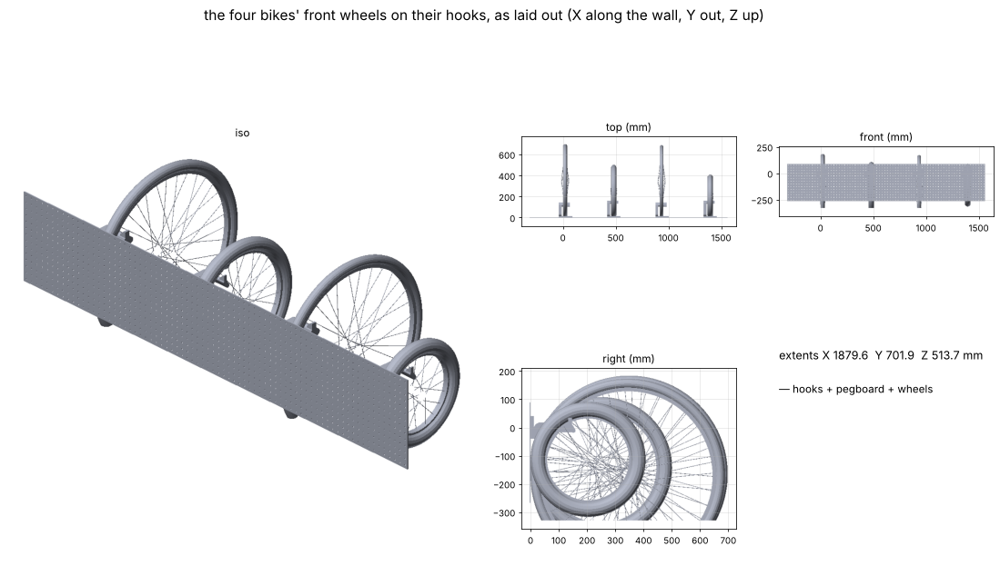
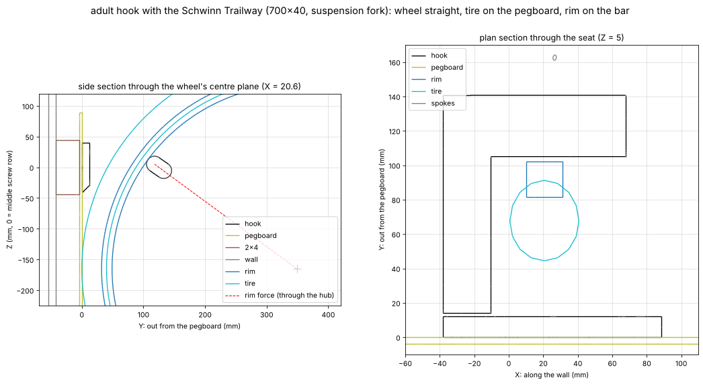

# Bike hooks (vertical, on the pegboard)

Wall hooks that hang the family's bikes vertically by their front rims. Each bike is perpendicular to the wall with its front
wheel straight, and both tires rest against the pegboard, as if the bike were riding up the wall. They screw through the
pegboard into a horizontal 2x4 behind it, about 6 ft up. Printed in PETG. There are two variants from one parametric model:
an **adult** hook for 700c hybrids and a **kids'** hook for 16 and 20 in wheels.

## Goal

Hooks that are clearly strong enough for the family's four (non-e) bikes hung off the ground, hold them with the wheel
straight and the tires on the wall, print without supports on the A1, and install with screws driven only into the 2x4's face.

## Status

- [x] v1 (2026-11-11): lip over the top of the 2x4, wheel turned to hook on. **Replaced**: the 2x4 is behind pegboard
      (only its face can take screws), and the owner wants the wheel straight with the tires on the wall
- [x] v2 (2026-11-11): plate on the pegboard + arm beside the wheel + bar through the spokes
- [x] v2.1 (2026-11-11): middle-row screw holes, so it works whether 2 or 3 hole rows are over the 2x4
- [x] v3 (2026-11-11): checked against the owner's four bikes (photos in `source/`); kids' variant for 16/20 in wheels;
      the 2x4 shows wood in 3 hole rows, so all 8 screws go in; suggested layout
- [ ] Owner: weigh the bikes, count the kids' front spokes, mock up the layout (see Open questions)
- [ ] Test print one adult hook, hang the Schwinn (the heaviest), check after a few weeks for any sag

## The bikes (estimated from the photos; not measured)

| Bike | Hook | Front wheel | Weight (est.) | Rim sits | Spoke clearance per side | Worst screw, hanging (3 rows) |
|---|---|---|---|---|---|---|
| Schwinn Trailway (suspension fork) | adult | 700×40 | 16.5 kg | 54° round | 10.7 mm (36 spokes) | 138 N |
| Trek FX 7.2 | adult | 700×35 | 12.5 kg | 52° round | 11.5 / 10.2 mm (32 / 36 spokes) | 102 N |
| Nishiki 20 in | kids | 20×1.95 | 12 kg | 36° round | 11.2 / 6.6 mm (28 / 36 spokes) | 99 N |
| Dynacraft 16 in (training wheels) | kids | 16×2.125 | 9.5 kg | 28° round | 11.6 / 4.2 mm (20 / 28 spokes) | 75 N |

"Rim sits" is where the rim meets the bar, measured round the wheel from its top on the wall side. "Spoke clearance" is at the
best wheel rotation: you turn the wheel to line up a gap as you hang it. Spoke counts aren't readable in the photos, so each wheel
is checked with the likely counts, laced crossed (3-cross adult, 2-cross 20 in, 1-cross 16 in).

## How it works

With the wheel straight and its tire on the wall, anything that comes straight out of the wall would hit the tire before
it reached the rim. So:

- **Plate** on the pegboard, with **8 screw holes on pegboard holes in three rows, 1 in apart**. The bar blocks the middle row
  everywhere except past its far end, so the plate reaches one column past the bar for the middle-row hole. Every hole can be
  driven straight in from the front.
- **Arm** comes straight out *beside* the wheel, clear of tires up to 50 mm (adult) or 58 mm (kids) wide.
- **Bar** turns 90° and reaches sideways through the spokes, just inside the rim. Its section is a slot that points at the hub.
  The rim's push points at the hub too, so the bar is deepest in the direction it's loaded. The spokes also point at the hub,
  so the bar is narrow across the gap between two of them.
- **The rim sits on the slot's rounded top end**, on the wall side. The rim's push there points through the hub, so the wheel hangs
  still even though it's free to spin. The same push pulls the wheel toward the wall, so the **front tire sits flat on the pegboard**.
  The rear tire leans on it too.
- **Tip**: a 45° ramp past the far side of the rim keeps the wheel from sliding off the end of the bar.

**The two variants** (`HOOKS` in `build.py`):

| | Adult (700c) | Kids (16 / 20 in) |
|---|---|---|
| Bar across the spoke gap × along the load | 26 × 44 mm | 16 × 38 mm |
| Seat (rim) centre out from the pegboard | 118 mm | 140 mm |
| Why | | Small wheels have their spokes much closer together, so the bar is slimmer. The seat is further out so small wheels hang lower and their tires clear the plate |

Both variants share the plate and screw pattern, and the bottom front edge of the plate is chamfered for tire clearance.

**To hang a bike:** stand it up on its rear wheel, front tire against the pegboard a little to the right of the hook (the bar
points right). Lift the front wheel about 4 cm so the rim clears the tip, turn the wheel so a spoke gap lines up with the bar,
slide it left onto the bar, and let it down. To take it down, lift, slide right, lower.

**Print orientation:** it lies on the arm's outer side. The arm bends along its layers, which is the strong way. The bar runs up
the print, so its bending pulls on layer bonds. That's why the bar's numbers below use lower PETG allowables.

## Strength (estimates, `report.json` → `bikes.*.loads`)

×3 is for the jolt of hanging a bike or knocking it. The screw figures are for all 8 screws, since three hole rows are over your 2x4.

| Check | Schwinn (heaviest, adult hook) | Nishiki (heaviest kid, kids' hook) |
|---|---|---|
| Rim force on the seat | 273 N: 162 N down + 220 N pulling the hook off the wall | 146 N: 118 N down + 86 N pulling |
| Arm root (along layers) | 2.9× to creep limit, 3.6× to break with the jolt | 4.5×, 5.6× |
| Bar root (across layers) | 3.4× to creep limit, 4.3× to break with the jolt | 2.3×, 2.9× |
| Worst screw pulling out | 138 N hanging: 4.2× under a #10's design value, 1.4× with the jolt | 99 N: 5.9×, 2.0× |

The Trek and the Dynacraft have larger margins than the bike shown for their hook. The pull-off force is weight × tan(where the rim sits),
which is why the adult seat sits ~118 mm out. **Don't hang an e-bike** without redoing the numbers.

## Measurements

| Feature | Value (mm) | Source | Notes |
|---|---|---|---|
| Pegboard | 3.94 thick, 6.35 holes on 25.4 | owner's board (`pegboard.DEFAULT_BOARD`) | Screws go through its holes |
| 2x4 behind it | 38 deep, 89 face, flat, ~1830 up (~6 ft) | owner photo 2026-11-11: wood shows through 3 hole rows; height from the owner | Use all 8 screws |
| Bikes | see the table above | models identified from the owner's photos | Weights and spoke counts are estimates: `BIKES` in `build.py` |

## Print settings

- **PETG**, as laid out in the STL (on the arm's side), **no supports**, 0.2 mm layers. Adult: 146 × 80 mm footprint, 127 mm tall.
  Kids: 160 × 80 mm, 127 mm tall.
- **5–6 walls, 30–40 % gyroid infill.** Strength is in the walls. Roughly 200–240 g each.
- Print **2 adult + 2 kids'**. Start with one adult hook and the Schwinn, since it's the heaviest load.

## Layout and heights

Hooks go **18 in (457 mm) apart, alternating adult, kid, adult, kid** (shown in the viewer as Schwinn, Nishiki, Trek, Dynacraft).
A hanging bike's handlebar sits roughly 1 m out from the wall for the hybrids and 0.65–0.8 m for the kids' bikes. So an adult's and a
kid's bars can overlap side to side without touching. Two adult bikes side by side would need ~26 in. The row needs about
**6.5 ft (2 m) of clear wall**, and anything on the pegboard behind the bikes has to move.

With the 2x4's middle at ~6 ft (rough, from the owner):

| | Front hub | Front tire top | Rear tire bottom (approx.) | Sticks out from the wall |
|---|---|---|---|---|
| Adult hybrids | ~1.66 m | ~2.0 m | ~0.25 m off the floor | ~1.0–1.1 m |
| Nishiki 20 in | ~1.69 m | ~1.94 m | ~0.6 m | ~0.8 m |
| Dynacraft 16 in | ~1.72 m | ~1.92 m | ~0.8 m | ~0.7 m |

The bikes hang high, so a grown-up hangs the kids' bikes. The tires sit near the wall only around hub height. Nothing on the
board within ~30 cm above the 2x4 should stick out more than ~15 cm.

## Install

1. Mock it up first: hold each bike in place against the board (tire on the board, front hub at ~5.5 ft) and mark where the
   wheel's centre is. Check pedals, bars and saddles clear the neighbouring bikes. Turning a crank so its pedals point up and down helps.
2. Each hook's plate sits **left of its wheel** (the arm is on the left; the wheel centre is ~21 mm right of the plate's "0" column).
   Keep the plates off the existing washer-head screws that hold the pegboard on.
3. Line up the plate's three hole rows with the three rows that show wood, and drive all **8** screws: **#10 or #12 × 2 in**
   washer-head or pan-head wood screws, through the pegboard holes into the 2x4, with 1/8 in pilot holes. That puts about 35 mm
   in the 2x4. Use a 6 in bit extension to reach past the bar.
   (If a spot only has 2 rows over wood, use the top and middle rows, 5 screws. Don't use middle + bottom.)
4. Optional: a strip of old inner tube on the seat protects the rim.

## Open questions

- **Weights:** stand on a bathroom scale holding each bike, minus your own weight. The Schwinn matters most. Above ~20 kg, recheck.
- **Kids' spokes:** count the spokes on the Nishiki and Dynacraft *front* wheels. The 16 in at 28 spokes only has 4.2 mm per side,
  which is fine but snug. More than 28 on the 16 in would need the bar slimmer.
- **Which side** should the arm be on? Right now it's left of the wheel as you face the wall, so you slide the bike on from the
  right. Mirroring is easy, and could differ per hook if that suits the layout better.

## Pipeline

`build.py` builds both variants (`HOOKS` → `model.py`), lays each on its side (`print_pose`), and exports STEP + STL. It checks a
screwdriver and bit can reach every hole straight on. Then, for each bike in `BIKES`, it:
- hangs its modelled front wheel (rim, tire, crossed spokes) with the tire on the pegboard and lowers it onto its hook's bar. It checks
  it's the rim, not the tire, that lands on the hook, with the wheel slid against the arm, centred, and against the tip
- turns the wheel about its axle to find the best and worst spoke gap for each likely spoke count (must be ≥ 4 mm)
- estimates the rim force, the stresses at the arm and bar roots, and the screw pull-out (elastic bolt group) for both install patterns.
  It asserts the margins

It also lays the four hooks and wheels out at `LAYOUT_X` for the viewer and `renders/in-use.png`.

## Files

- `output/bike-hook-adult.stl`, `output/bike-hook-kids.stl`: print these (Bambu Studio)
- `output/bike-hook-adult.step`, `output/bike-hook-kids.step`: editable solids for Fusion
- `output/report.json`: per-variant checks and params, per-bike fit and loads
- `renders/model-adult.png`, `renders/model-kids.png`: print poses; `renders/in-use.png`: the layout;
  `renders/sections-adult.png` (Schwinn), `renders/sections-kids.png` (Dynacraft): side + plan sections
- `source/photo-2026-11-11-*.jpg`: the owner's photos of the bikes, the wall, and the 2x4 through the pegboard
- **Viewer artifact:** https://claude.ai/artifact/J58YQJDJZxmdjDr6LM3aJt (publish updates to this URL)

## Log

- **2026-11-11:** Project started from the owner's brief: PETG, hang the bike vertically by the front wheel at about head
  height, screwed to a horizontal 2x4 on the studs. v1: lip over the top of the 2x4 with screws down through it, plus a plate on
  the face. Tapered arm with a 35 mm tip, which needs the wheel turned ~80° to hook on. Viewer published.
- **2026-11-11 (v2):** Owner: the 2x4 is behind pegboard, so only face screws are possible, and they want the bike perpendicular to the
  wall with the tires resting on it. Redesigned: plate on the pegboard with screws through its holes, an arm beside the wheel, and a
  bar that reaches sideways through the spokes. The rim sits on the bar ~53° round from the top, so the rim's push goes through the
  hub and pulls the tire onto the board. The bar's section is a slot pointing at the hub. Prints on its side with no supports.
- **2026-11-11 (v2.1):** The owner wasn't sure both screw rows would land over the 2x4, so the plate now has 8 holes in three rows (one
  column past the bar, the only place a driver can reach the middle row). 3 rows: all 8. 2 rows: top + middle.
- **2026-11-11 (v3):** Owner sent photos of the four bikes, the wall, and the 2x4 through the pegboard. Three hole rows show wood, so
  the 2x4 is flat and all 8 screws go in. It's ~6 ft up. Identified the bikes: Trek FX 7.2 and Schwinn Trailway (700c), Nishiki 20 in,
  Dynacraft 16 in. Spokes are now modelled crossed, not radial. The adult hook fits both hybrids (≥10 mm spoke clearance). It would not
  fit the kids' wheels (3.4 mm or less on the 20 in, and the 16 in tire hits the plate). Added a kids' variant: bar 16 × 38 mm, seat at
  140 mm. Also added a 10 mm chamfer on every plate's bottom edge. Each bike is checked against its hook in the build. Suggested layout
  18 in apart, alternating adult/kid (~2 m of wall). Waiting on the owner: weights, kids' spoke counts, a mock-up of the layout.
