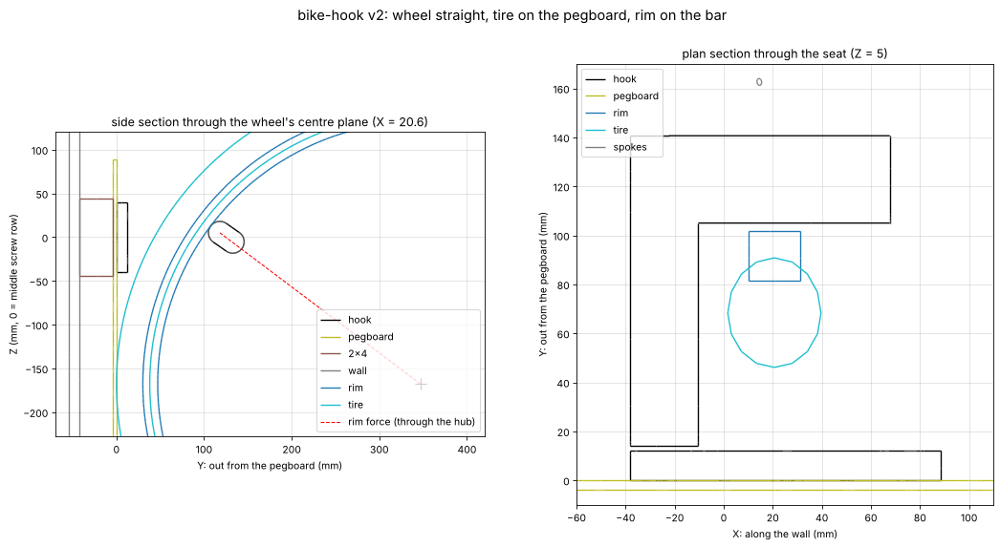

# Bike hook (vertical, on the pegboard)

A wall hook that hangs a bike vertically by its front rim. The bike is perpendicular to the wall with the front wheel
straight, and both tires rest against the pegboard, as if the bike were riding up the wall. It screws through the
pegboard into a horizontal 2x4 behind it. Printed in PETG.

## Goal

A hook that is clearly strong enough for an everyday (non-e) bike hung off the ground, holds it with the wheel straight
and the tires on the wall, prints without supports on the A1, and installs with screws driven only into the 2x4's face.

## Status

- [x] v1 (2026-11-11): lip over the top of the 2x4, wheel turned to hook on. **Replaced**: the 2x4 is behind pegboard
      (only its face can take screws), and the owner wants the wheel straight with the tires on the wall
- [x] v2 (2026-11-11): plate on the pegboard + arm beside the wheel + bar through the spokes; checks in `report.json`
- [x] v2.1 (2026-11-11): middle-row screw holes, so it works whether 2 or 3 hole rows are over the 2x4
- [ ] Owner's numbers: bike weight, wheel/tire size, spoke count, where the 2x4 is behind the pegboard (see Open questions)
- [ ] Owner review of the viewer
- [ ] Test print, hang the bike, check after a few weeks for any sag

## How it works (v2)

With the wheel straight and its tire on the wall, anything that comes straight out of the wall would hit the tire before
it reached the rim. So:

- **Plate** on the pegboard, with **8 screw holes on pegboard holes in three rows, 1 in apart**. The 2x4's 3.5 in face covers
  either 2 or 3 hole rows, depending on where the grid falls, so the hook works either way (see Install). Every hole can
  be driven straight in from the front. The bar blocks the middle row everywhere except past its far end, so the plate
  reaches one column past the bar for the middle-row hole. The bar sits ~110 mm out, so use a 6 in bit extension.
- **Arm** comes straight out *beside* the wheel, clear of tires up to 50 mm (2 in) wide.
- **Bar** turns 90° and reaches sideways through the spokes, just inside the rim. Its section is a 26 × 44 mm slot that points at the hub.
  The rim's push points at the hub too, so the bar is deepest in the direction it's loaded. The spokes also point at the hub,
  so the bar is narrow across the gap between two of them: 10.8 mm to spare per side on a 32-spoke wheel.
- **The rim sits on the slot's rounded top end**, about 53° round from the top of the wheel, on the wall side. The rim's push there
  points through the hub, so the wheel hangs still even though it's free to spin. The same push pulls the wheel toward the wall,
  so the **front tire sits flat on the pegboard**. The rear tire leans on it too.
- **Tip**: a 45° ramp past the far side of the rim keeps the wheel from sliding off the end of the bar. To get past it, the
  bike would have to be lifted.

**To hang the bike:** stand it up on its rear wheel, front tire against the pegboard a little to the right of the hook (the bar
points right). Lift the front wheel about 4 cm so the rim clears the tip, slide it left so the bar goes between two spokes
under the rim, and let it down. The rim settles onto the seat and the tire onto the board. To take it down, lift, slide right, lower.

**Print orientation:** it lies on the arm's outer side. The arm bends along its layers, which is the strong way. The bar runs up
the print, so its bending pulls on layer bonds. That's why the bar's numbers below use lower PETG allowables.

## Strength (v2 estimate, `report.json` → `loads`)

Assumes a **16 kg bike** (not measured yet) and ×3 for the jolt of hanging it or knocking it.

| Check | Hanging | With ×3 jolt | Margin |
|---|---|---|---|
| Rim force on the seat (53° round) | 261 N: 157 N down + 208 N pulling the hook off the wall | | |
| Arm root (along layers) | 2.6 MPa | 7.9 MPa | 3.0× to creep limit, 3.8× to break |
| Bar root (across layers) | 1.1 MPa | 3.4 MPa | 3.5× to creep limit, 4.4× to break |
| Worst screw, pulling out: 3 rows over the 2x4 | 132 N | 400 N | 4.4× under a #10's design value hanging, 1.5× with the jolt |
| Worst screw, pulling out: only 2 rows (top + middle) | 206 N | 620 N | 2.8× under the design value hanging; just over it with the jolt (a design value is already ~1/5 of real failure) |

The pull-off force is weight × tan(contact angle). That's why the seat sits ~118 mm out: closer to the wall, the rim sits
further round the wheel and the pull climbs fast. The screws are the limit, so **don't hang an e-bike** without redoing the numbers.

## Measurements

Nothing measured yet. These are the assumptions, and all of them are parameters:

| Feature | Assumed (mm) | Source | Notes |
|---|---|---|---|
| Pegboard | 3.94 thick, 6.35 holes on 25.4 | owner's board (`pegboard.DEFAULT_BOARD`) | Screws go through its holes |
| 2x4 behind it | 38 deep, 89 face | assumed | Flat (3.5 in face toward the pegboard), so 2 or 3 hole rows are over it |
| Bike weight | 16 kg | typical | `BIKE_MASS_KG` in `build.py` |
| Wheel | 700c, 38 mm tire (outer radius 347), 32 spokes | typical | `WHEEL` in `build.py`. The hub hangs 168 mm below the middle screw row |
| Widest tire / rim the slot takes | 50 / 30 | design | `tire_max_w`, `rim_max_w` |

## Print settings

- **PETG**, as laid out in the STL (on the arm's side), **no supports**, 0.2 mm layers. 146 × 80 mm footprint, 127 mm tall
  (the plate is the tall part).
- **5–6 walls, 30–40 % gyroid infill.** Strength is in the walls. Roughly 200–240 g.
- The screw holes are horizontal in the print, so they have teardrop points (no sagging bridge).

## Install

1. Find the 2x4 behind the pegboard (a stud finder works through hardboard, or poke a thin wire through a hole) and note which
   hole rows have at least ~12 mm of wood above and below them. Its 3.5 in face covers **3 rows** or **2 rows**.
2. **3 rows:** line up the hook's three hole rows with them and use all **8** screws.
   **2 rows:** line up the hook's **top and middle** rows with them, and use those **5** screws (4 top, 1 middle). This hangs
   the bike 1 in lower than the other option. Don't use middle + bottom: those screws sit below where the bike pulls, and the
   top screws would carry more than twice the load.
3. Drive **#10 or #12 × 2 in** washer-head or pan-head wood screws through the pegboard holes into the 2x4, with 1/8 in
   pilot holes. That puts about 35 mm in the 2x4. Use a 6 in bit extension to reach past the bar.
4. Optional: a strip of old inner tube on the seat protects the rim.

## Open questions

- **The 2x4:** is it flat (3.5 in face toward the pegboard) or on edge (1.5 in face)? On edge, only one hole row would land on
  it, and the plate would need re-planning. How high is it?
- **Bike:** weight, and is any of them an e-bike?
- **Wheel:** size (700c / 29 / 27.5 / 26), tire width, spoke count. Tire size changes where the rim sits on the bar (and so the
  pull on the screws). A 27.5 or 26 in wheel needs the bar moved.
- **Which side** should the arm be on? Right now it's left of the wheel as you face the wall, so you slide the bike on from the right.
  Mirroring is easy.

## Pipeline

`build.py`: builds the hook (`model.py`), lays it on its side (`print_pose`) and exports STEP + STL. Then it:
- checks a screwdriver and bit can reach each screw straight on
- hangs a modelled wheel (rim + tire + spokes) with its tire on the pegboard and lowers it onto the bar. It checks it's the rim, not
  the tire, that lands on the hook, for this tire and the widest one, and with the wheel slid against the arm, centred, and against the tip
- turns the wheel about its axle to find the best and worst spoke gap
- estimates the rim force, the stresses at the arm and bar roots, and the screw pull-out (elastic bolt group) for each install
  pattern (`install_patterns` in `model.py`: 3 rows, or top + middle)

Hook parameters are in `HookParams` (`model.py`). Board, bike and wheel assumptions are at the top of `build.py`.

## Files

- `output/bike-hook.stl`: print this (Bambu Studio)
- `output/bike-hook.step`: editable solid for Fusion
- `output/report.json`: checks, params, wheel fit, loads
- `renders/model.png`: print pose; `renders/in-use.png`: on the pegboard with a wheel; `renders/sections.png`: side + plan sections
- **Viewer artifact:** https://claude.ai/artifact/J58YQJDJZxmdjDr6LM3aJt (publish updates to this URL)

## Log

- **2026-11-11:** Project started from the owner's brief: PETG, hang the bike vertically by the front wheel at about head
  height, screwed to a horizontal 2x4 on the studs. v1: lip over the top of the 2x4 with screws down through it, plus a plate on
  the face. Tapered arm with a 35 mm tip, which needs the wheel turned ~80° to hook on. Viewer published.
- **2026-11-11 (v2):** Owner: the 2x4 is behind pegboard, so only face screws are possible, and they want the bike perpendicular to the
  wall with the tires resting on it. Redesigned: plate on the pegboard with 5 screws through its holes, an arm beside the wheel, and a
  bar that reaches sideways through the spokes. The rim sits on the bar ~53° round from the top, so the rim's push goes through the hub
  and pulls the tire onto the board. The bar's section is a slot pointing at the hub: strong the way it's loaded, and 10.8 mm clear of
  the spokes per side. Prints on its side with no supports. Margins for a 16 kg bike with a ×3 jolt: arm 3.8×, bar 4.4×, and screws at
  their design value. Waiting on the owner: how the 2x4 is oriented and where, bike weight, wheel size.
- **2026-11-11 (v2.1):** The owner isn't sure both screw rows (2 in apart) will land over the 2x4, so they asked for middle-row holes too.
  The bar and arm block a driver everywhere in the middle row except past the bar's far end. So the plate now reaches one column
  further (76 → 127 mm wide), with 8 holes: top row at −1, 0, 1, 3 in; middle row at 3 in; bottom row at 0, 1, 3 in. With 3 rows over
  the 2x4, use all 8 (worst screw 132 N hanging). With 2, use top + middle (5 screws, worst 206 N, about the same as v2). Middle +
  bottom would be 476 N, so the README says not to use it.
