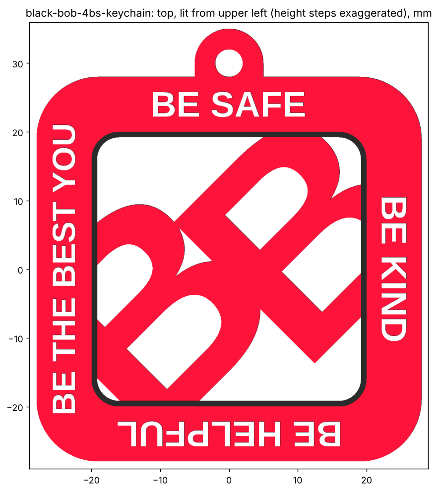

# Black Bob "4 B's" keychain

A second Black Bob Elementary keychain. It has a big tilted BB, cropped by its window, framed by the school's four B's:
**Be safe, Be kind, Be helpful, Be the best you.** Red, white, black, like the [logo keychain](../black-bob-keychain/).

## Goal

The owner picked concept **C2d** from the workshop sketches: a rounded-square red frame with one B per side. Since v3:
Be safe on top, Be kind on the right, Be helpful on the left, Be the best you on the bottom; top and bottom both read upright. A black line runs on the inside edge of the frame. In the white window sit two big red Bs,
tilted 45°, staggered (the first higher), overlapping, and cropped by the window. **The overlap is separated by height
only** (owner: "we could use height"): the front B stands above the back one, with no gap or outline. **Neither B may stand
above the black line** (owner, v2): the front B is flush with it.

## Status

- [x] Workshopped layouts A–D, then C variants (crop/angle), C2 spacing, C2d overlap treatments (sketches only, not kept)
- [x] v1: built C2d. 56 × 63 × 4.0 mm, watertight, 0 self-intersections, Euler 0 (the tab hole)
- [x] Owner review of v1: the BB can't be higher than the black border
- [x] v2: front B flush with the black line (3.4), back B 2.8. 3.8 mm thick (the frame text is the top)
- [x] Owner review of v2: Be helpful to the left, Be the best you to the bottom, bottom text upright like the top
- [x] v3: sides rearranged, bottom upright
- [x] Owner review of v3: likes the design. Talked through print waste (below)
- [x] v4: black only 0.4 deep (was 0.8): 2 three-colour layers instead of 4, ~4 fewer AMS swaps. Looks the same
- [ ] Test print
- [ ] Test print (P2S + AMS): check the front/back B step reads, and the small "BE THE BEST YOU"

## Measurements

No real measurements. The size is the designer's choice and matches the concept sketch.

| Feature | Value (mm) | Notes |
|---|---|---|
| Frame | 56 square, corner R 9 | `SIZE`, `CORNER_R`. Overall 56 × 63 with the tab |
| Frame band | 8 | `FRAME_W`, outer edge to the black line |
| Black line | 0.8 wide | `LINE_W`, 2 extrusion widths, on the inside edge of the frame |
| White window | 38.4 square, corner R 3.2 | |
| Frame text | cap 3.6; "BE THE BEST YOU" 3.24 (bottom, upright) | Liberation Sans Bold. The long one is shrunk to fit 42 mm (`TEXT_MAX_LEN`) |
| Bs | cap 29, tilted 45°, pitch 23.9, stagger 8 | `BB_*`. The B advance is ~28.9, so they overlap ~5. `BB_FRONT = 2`: the right B is in front |
| Heights (tops) | base 0.8, window 2.4, back B 2.8, front B = frame + line 3.4, text 3.8 | Front B is 0.6 (3 layers) above the back B, flush with the line. Total 3.8 |
| Colour depth | white 1.6, black 0.4 | Red below. 1.6 white came from keychain #1 (1.0 printed pinkish). Black is opaque at 0.4 (v4, was 0.8) |
| Keyring hole | 4.0, 3.0 wall | Tab centred on top |
| Smallest feature | 0.4 | Crop slivers narrower than that are dropped (`MIN_FEATURE`) |

## Print settings

- **P2S + AMS 2 Pro** (A1 works too): red, white, black. PLA is fine; PETG holds up better on keys.
- Open `output/black-bob-4bs-keychain-multicolor.3mf`, and load it as one object with multiple parts if asked. Set the
  parts to red, white, black. Flat, back down, no supports, 0.2 mm layers (19 layers).
- Layers 1–4 are all red. Colour swaps start at 0.8 mm.
- **Waste (v4):** per plate, layers 5–13 are red + white (~1 swap each), 16–17 red + white + black (~2 each), so ~15 swaps
  (v3: ~17). One keychain is ~12 g (red 10.1, white 1.9, black 0.05); alone it purges more than that.
  **Fill the plate** (~9–12 fit beside the prime tower): copies share the swaps, so purge per keychain drops below ~1 g.
  Check "Flushed" in Bambu Studio's slice preview.
- Slicer savings to try: flush multiplier ~0.7–0.8 for changes into red or black (keep full into white), a narrow prime
  tower, "Flush into this object" on a single-colour part on the same plate.
- PLA softens ~55 °C: use PETG for keychains that live in a car.

## Open questions

- More waste savings, not done (owner's call): white base instead of red (the first ~9 layers white-only, ~10 swaps,
  but a white back and red over ~1 mm of white may print lighter); white text starting at 2.8 instead of 2.2 (~2–4 fewer
  swaps, but risks pink text).

- Is the 0.6 mm step enough to separate the two Bs? The front B can't go higher (the line caps it), so a bigger step means
  a lower back B (`BACK_B_TOP`, min ~2.6) or raising the frame and line together (`FRAME_TOP`).
- Size: 56 mm (sketch), or 60 to match keychain #1?
- Which B in front (`BB_FRONT`), and how much overlap (`BB_PITCH`)?

## Pipeline

`build.py`: all 2D in shapely first (drawing coords, Y up, mm). Text is Liberation Sans Bold via matplotlib `TextPath`,
flattened at 100× so the curves are smooth. The Bs are placed in their own frame (pitch, stagger), tilted together,
and cut by the window. Then slivers under `MIN_FEATURE` are dropped (`opening`) and joined to the back B. Regions are snapped to a 1 µm grid (`set_precision`) so neighbours share exact
vertices; without it, v2 had a degenerate sliver triangle where the Bs meet. Regions are
disjoint, and each has a colour and a top. Each colour body is stacked from flat slabs (one per height interval) and
unioned with manifold3d. Keep manifold's vertices (`process=False`): merging them turns the one pinch point (a B tip
touching the other B) into a non-manifold edge.

## Files

- `output/black-bob-4bs-keychain-multicolor.3mf`: print this (3 parts)
- `output/black-bob-4bs-keychain.stl`: single-colour solid
- `output/black-bob-4bs-keychain-{red,white,black}.stl`: colour bodies
- `renders/relief.png`, `renders/relief-overlap.png`, `renders/heights.png`, `renders/model.png`
- **Review page:** https://claude.ai/artifact/AJfe2ZpCpQAtfduTFEBzjr (`renders/viewer.html`; republish to this URL)

## Log

- **2026-11-16 (v4):** Owner liked v3 and asked about printer and waste concerns. Swaps come from mixed-colour layers, not
  colour volume: ~17 per plate in v3. Options: fill the plate, thinner black, white base, shallower white text, slicer flush
  settings. Owner picked the thinner black: `COLOUR_DEPTH` black 0.8 → 0.4 (black now 3.0–3.4), ~15 swaps.

- **2026-11-16 (v3):** Owner: put Be helpful on the left, move Be the best you to the bottom, and make the bottom read the same way
  as the top. `SIDES` now holds (text, side, text rotation): the bottom is upright, the left reads bottom-to-top, the right top-to-bottom.

- **2026-11-16 (v2):** Owner: "The BB cannot be higher than the black border." Front B 4.0 → 3.4 (flush with the line and frame),
  back B 3.2 → 2.8, which keeps a 0.6 step between them. The frame text (3.8) is now the high point, and it's 3.8 thick (was 4.0).

- **2026-11-16 (v1):** Workshopped with the owner using 2D sketches. Layouts: A full ring, B logo-style arcs, C rounded square with one
  B per side, D quadrants. Picked C with a much bigger, tilted BB that overflows the window. Of the C variants (20°/45° clipped,
  bleeding under the frame, solid black), picked C2 (45°, clipped). Then: move the black outline from the letters to the
  inside of the red frame, and put the Bs closer and staggered up and down; picked C2d (overlapping). For the overlap, the owner
  chose height over a white gap or black line. Built v1 and published the review page.
