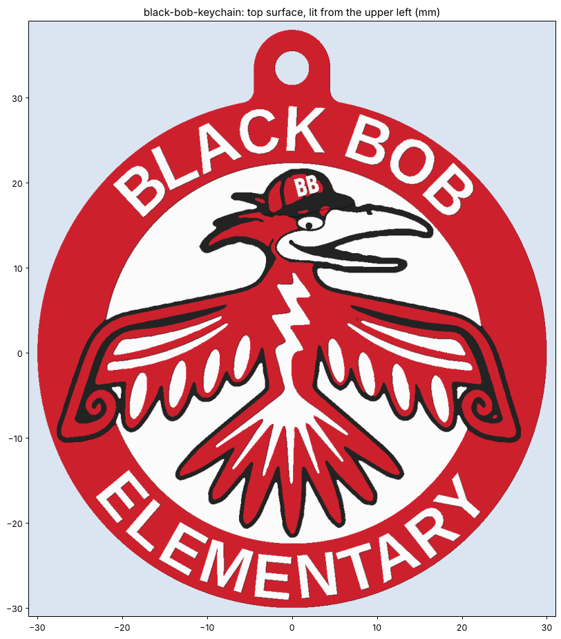

# Black Bob Elementary keychain

A multicolour keychain of the Black Bob Elementary logo (the thunderbird in a cap, inside the red name ring), with
height steps between the colours. Several will print on one plate.

## Goal

A keychain that reads like the logo and feels layered: the red ring is a raised bezel, the letters are embossed, the bird
stands off a recessed white field, and the cap is the highest point (owner's pick, "style A"). The back is plain.

## Status

- [x] Source: `source/logo-2026-11-12-school-site-300px.png`, the school site's original upload. 300 px is the largest
      that exists there (Cloudinary returns the same 300 px for the untransformed original). `…-web-300px.webp` is the
      owner's lossy copy, kept for reference only.
- [x] v1: traced, style A heights, 60 mm, keyring tab. Watertight, 0 self-intersections, Euler 0 (the tab hole)
- [x] v2: owner asked for crisp lines, not bumpy or wavy. Ring letters set in a font (fitted per letter), cap and beak
      redrawn as splines, the rest of the trace smoothed (corners kept), black thickened evenly in vector space
- [x] v3: owner said v2's beak and "BB" looked nothing like the original. Beak and cap are traced again (no redraw),
      with a sub-pixel trace that keeps edges smooth. "BB" is a font fitted onto the logo's own BB. Grey visor (4th colour)
- [x] v4: owner wanted the whole cap bill black (back to 3 colours) and the eye revisited. The eye is now drawn (`EYE`)
- [x] v5: owner found v4's eye creepy (a small centred pupil reads as a stare). From four styles they picked "friendly":
      a big pupil with a white highlight, no lid
- [x] v6: removed a white sliver and black spike right of the eye: the logo's grey eye ring, traced outside the
      (smaller) drawn eye. That area is now beak white (`EYE_CLEAR`, `EYE_CLEAR_EDGE`)
- [x] v7: owner: "we're getting further away", match the original and keep it printable. Studied the logo pixel by pixel. The eye is
      rebuilt from its pixels (`EYE_PX`): under the bill, the pupil low-left touching the bottom outline. Red is kept to 0.25 mm
- [ ] Owner review of v7 (viewer link below)
- [ ] Test print (P2S + AMS), then adjust heights and line widths

## Measurements

No real measurements. The size is the owner's choice: "55 or 60 mm". **60 mm** was picked to keep the wing slits and tail rays printable.

| Feature | Value (mm) | Notes |
|---|---|---|
| Diameter (outside of the red ring) | 60.0 | `DIAMETER`. The logo's thin white outer rim is left off (~0.8 mm, too fragile/dirty on a keychain) |
| Overall incl. tab | 60 × 68 | |
| Heights (top of each colour) | red base 0.8, white field 1.8, cut-in white details 2.4, red ring 2.8, bird + outline + beak 3.0, letters 3.2, cap 3.4 | Style A |
| Colour depth | white 1.0, black 0.8 | Below that it's red (`COLOUR_DEPTH`), so fewer layers hold all three colours |
| Keyring hole | 4.0, 2.5 wall | Tab at 12 o'clock, outside the ring so it doesn't cut "BLACK BOB" |
| Black lines | ~0.3 and up, grown 0.03/side | As thin as the logo's. Bambu Studio's Arachne prints thin lines at ≥ ~0.34 |
| Smallest white / red detail | white 0.3, red 0.25 | Narrower bits are dropped (become black). Bambu's Arachne prints ~0.34 minimum, so these come out a hair wider |
| Smoothing | σ 0.15 along the outline | Light, since the trace is already sub-pixel; corners sharper than 40° stay sharp |
| Ring letters | ~5.2 tall | Liberation Sans Bold (`source/LiberationSans-Bold.ttf`, SIL OFL) |
| "BB" on the cap | ~2 tall, tilted like the logo's | DejaVu Sans Bold fitted onto the traced BB (best overlap of 7 fonts, 0.70), at 92% so the red shows around it, thickened 0.05/side |
| Cap bill | black | Grey in the logo. The owner chose black to keep 3 colours. Found under `VISOR_PX` |
| Eye | eyeball ~2.9 × 1.4 (top cut by the bill), rim 0.25, pupil Ø 0.8 | Drawn from the logo's pixels (`EYE_PX`). The pupil sits low-left and meets the bottom outline |
| White details in the bird | ≥ 0.45 wide | Narrower slits are dropped (become red) |

## Print settings

- **P2S + AMS 2 Pro** (A1 works too): red, white, black. PLA is fine. PETG holds up better on keys.
- Open `output/black-bob-keychain-multicolor.3mf`. If Bambu Studio asks, load it as one object with multiple parts,
  then set the parts: red, white, black. Flat, back down, no supports, 0.2 mm layers (17 layers).
- Layers 1–4 are all red. The colour swaps run from 0.8 mm up. For a plate of several, add copies in Bambu Studio:
  they share the swaps, so the purge per keychain goes down.
- Single colour: `output/black-bob-keychain.stl` (the relief still shows. Paint or ink the top if you like).

## Open questions

- Is the black outline too heavy? It had to grow to print. Alternative: drop the black and let the height step
  outline the bird (2 colours, much less purge).
- Should the heights be bigger? The total is now 3.4 mm.
- Is 4 mm right for their split ring?

## Pipeline

`build.py`:
- **Trace:** two smooth fields, redness R−(G+B)/2 and lightness (G+B)/2, are upsampled 8× with a cubic spline, so the edges
  come out sub-pixel from the logo's own anti-aliasing. Each point goes to the nearest of red, white or black in that plane,
  so blends split at their midpoint. Black hairlines that the spline leaves at sharp red/white edges are dropped. The cap's
  grey bill is found under `VISOR_PX` and printed black.
- **Regions:** the circles are fitted to the ring edges. Bird = the filled black outline. White inside the bird is split into raised
  (beak, eye: `RAISED_WHITE_BOX_PX`) and cut-in (slits, bolt, tail rays). The cap outline is `CAP_PX`. The outlines are smoothed
  lightly with the corners kept (`smooth_ring`).
- **Fonts:** the ring letters are font glyphs, each fitted onto its traced letter (`fit_letters`; the touching "LA" is fitted as a pair).
  "BB" is fitted onto the traced BB blob (`fit_bb`: tilt by best overlap). The eye is drawn (`draw_eye`).
- **Mesh:** all region outlines are noded into one planar partition (`partition`, 1 µm grid). Each colour body is built straight from it as
  columns with shared vertices (`column_mesh`): caps by constrained Delaunay, walls only where neighbouring columns differ.
  There are no booleans, so it's watertight by construction. Where two columns touch only at a corner, a 0.02 mm disc moves to a
  neighbour (`separate_pinches`).
- v2's redrawn cap and beak (splines) were dropped in v3. They didn't look like the logo.

## Files

- `output/black-bob-keychain-multicolor.3mf`: print this (3 parts)
- `output/black-bob-keychain.stl`: single-colour solid
- `output/black-bob-keychain-{red,white,black}.stl`: colour bodies
- `renders/layout.png` (source vs colours vs heights), `renders/compare-head.png` (logo vs model), `renders/relief*.png`, `renders/model.png`
- **Review page:** https://claude.ai/artifact/5FYvjmwh3QfyWj5R3MaU21 (`renders/viewer.html`; republish to this URL)

## Log

- **2026-11-12 (v7):** Owner: "we're getting further away"; match the original, still printable. A pixel-level study found:
  beak line widths already match (~0.7 mm); the drift was around the head. Thin red was dropped to black. The eye was a
  free-floating round eye, but in the logo it's tucked under the bill with a low-left pupil (that reads friendly). Rebuilt the eye from the
  logo's pixels. Dropped v6's clearing hack. Kept red down to 0.25 mm. Not yet fixed: the red tongue streaks in the lower jaw, and some
  red in the head crest (dark red in the logo, which reads as black).
- **2026-11-12 (v6):** Owner: a white sliver right of the eye isn't in the original. It was the trace of the logo's grey eye ring (a
  black spike, with white between it and the drawn eye). Cleared to beak white, up to a line from the eye's top along the beak's
  upper edge, keeping the red patch under the bill.
- **2026-11-12 (v5):** Owner: v4's eye was "creepy". Showed four eye styles (under the brim, friendly, determined, looking ahead),
  each with a big pupil and a highlight. The owner picked friendly. The highlight is 0.5 mm: smaller ones got dropped as specks.
- **2026-11-12 (v4):** Owner: "looks better". Whole cap bill black (keep 3 colours), and revisit the eye. The eye is now drawn:
  a white eyeball, black rim, round pupil. Thin red slivers left around it are dropped.
- **2026-11-12 (v3):** Owner: "the beak and the hat BB lettering now look nothing like the original." Went back to tracing
  them, with a better trace (sub-pixel, colour-blend aware) and much thinner black, plus a fitted "BB" and a grey visor. Replaced the
  slab/boolean meshing with a direct column mesher (the booleans kept leaving non-manifold edges).
- **2026-11-12 (v2):** Owner: "Lines should be crisp and not bumpy or wavy." Ring letters are now Liberation Sans Bold. It was picked by
  overlap with the traced letters (0.88 mean, the best of 6 bold sans tried). The cap and beak are redrawn as splines, and the rest of the bird is smoothed.
- **2026-11-12:** Workshopped options with the owner. Picked 55–60 mm, style A heights, plain back, several per plate.
  The owner sent the school site's image URL. Its original is also 300 px, but lossless, so it's the source. Built v1 at 60 mm and published the review page.
