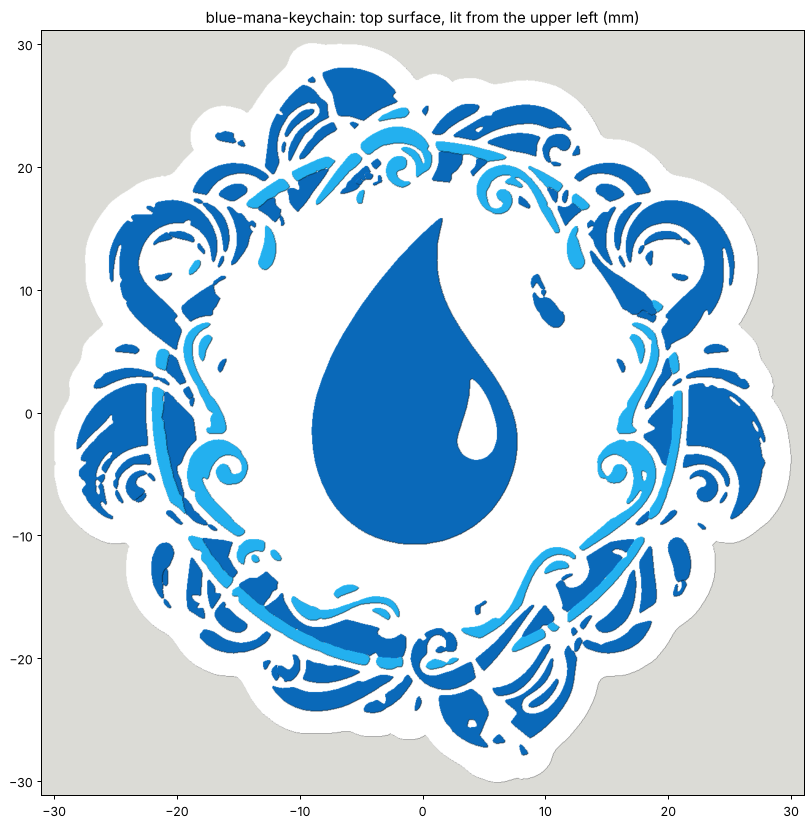

# Blue mana keychain

A multicolour keychain of the owner's blue mana sticker art (a water drop in a ring of swirling waves), in the style of
[black-bob-keychain](../black-bob-keychain/): traced from the art, with each colour at its own height. Several will print on one plate. Since v3 it has no keyring tab (the person it's for doesn't need one), so it's a
flat token/badge; the project keeps its name.

## Goal

A keychain that reads like the sticker and feels layered: the drop is the highest point, the swirl ring stacks the way
the art does (slate waves behind, royal in the middle, cyan in front), and the white field sits lowest. The back is plain.

## Status

- [x] Source: `source/blue-mana-2026-11-27-sticker-570px.jpg`, the image the owner sent (570 px JPEG, a die-cut sticker mock-up)
- [x] v1: traced, 4 colours (white, slate, royal, cyan: fills the AMS), 60 mm wide, keyring tab. Watertight, 0 self-intersections, Euler 0 (the tab hole)
- [x] Owner review of v1: "looks nice", checkpointed (commit 45a6a17). Asked to try 3 colours
- [x] v2: 3 colours: the slate waves print royal (`PRINT_AS`), keeping their own height. The 4-colour 3MF is still built
- [x] Owner review of v2: "looks good". The person it's for doesn't need a keychain attachment
- [x] v3: no keyring tab (`KEYRING_TAB = False`): just the sticker shape, ~60 × 60. Euler 2 (one solid, no hole)
- [ ] Owner review of v3, then test print
- [ ] Test print (P2S + AMS), then adjust heights and line widths

## Measurements

No real measurements. The size is a pick, matching the Black Bob keychain's 60 mm.

| Feature | Value (mm) | Notes |
|---|---|---|
| Width (sticker outline) | 60.0 | `WIDTH`. The sticker's white border is kept as the rim (~1.5–2.5 wide) |
| Overall | 60 × 60 | No tab since v3 (was 60 × 68 with it) |
| Heights (top of each colour) | white base 0.8, white field 2.0, drop highlight 3.0, slate 2.4, royal 2.8, cyan 3.2, drop 3.6 | Total 3.6 |
| Print colours | white, royal, cyan | v2. Slate prints royal (`PRINT_AS`); the 4-colour 3MF keeps slate |
| Colour depth | royal 0.8, slate 1.0, cyan 1.0 | Below that it's white (`COLOUR_DEPTH`). Blue over white hides well, unlike white over red on Black Bob |
| Keyring tab | off (`KEYRING_TAB`) | When on: 4.0 hole, 2.5 wall, at 12 o'clock on the outline's top scallop |
| Smallest colour line | 0.3 | `MIN_LINE`. Thinner lines and tips are merged away. Arachne prints ~0.34 minimum |
| Smallest white gap | 0.25 | `MIN_GAP`. Thinner gaps close up (that's also what removes the texture's scratches) |
| Smallest island / hole | 0.2 mm² | `MIN_AREA` (the texture's specks) |
| Scale | 0.134 mm per source px | |

## Print settings

- **P2S + AMS 2 Pro** (A1 + AMS lite works too): white, royal blue, cyan. PLA is fine; PETG holds up better on keys.
- Open `output/blue-mana-keychain-multicolor.3mf`. If Bambu Studio asks, load it as one object with multiple parts,
  then set the parts: white, royal, cyan. For v1's 4 colours, open `output/blue-mana-keychain-4colour-multicolor.3mf`
  (white, slate, royal, cyan). Flat, back down, no supports, 0.2 mm layers (18 layers).
- Layers 1–4 are all white. Colour swaps run from 1.2 mm up.
- Single colour: `output/blue-mana-keychain.stl` (the relief still shows).

## Open questions

- Close enough to the art? The distressed texture, the hatched shadow under the drop, and lines under 0.3 mm are left out
  on purpose. Some thin swirls break into pieces where the art's lines are thinner than a nozzle line.
- With 3 colours, do the royal back waves (2.4) still read as separate from the royal swirls (2.8)? If not, a bigger step
  (e.g. back waves 2.3, royal swirls 3.0) would help.
- Size: 60 mm like Black Bob, or bigger (65–70) so more of the fine swirl detail survives?

## Pipeline

`build.py` (the meshing lives in the shared `tools/relief.py`, taken from black-bob-keychain's build):
- **Outline:** the sticker's grey die-cut line (one 2 px wide connected piece) is filled. That shape is the keychain,
  so the white border is the rim. Scaled so it's `WIDTH` across and centred on it.
- **Trace:** blurred lightly (σ 0.6 px, JPEG noise), upsampled 4× (cubic), and every point classed as one of the four
  palette colours (k-means of the image). A point that fits a blend of two colours better (by `BLEND_BIAS`) goes to the nearer end,
  so anti-aliased edges split at the midpoint (otherwise a royal/white edge reads as a slate fringe).
- **Tidy:** white thinner than `MIN_GAP` and colour thinner than `MIN_LINE` are opened away, and islands under `MIN_AREA`
  merged, each taking the nearest colour that's left. This also removes the sticker's distressed texture.
- **Regions:** the drop is the royal piece at `DROP_SEED_PX`; its hole is the highlight. Contours are smoothed along their
  length (σ `SMOOTH`, corners over `CORNER_DEG` kept sharp).
- **Mesh:** `relief.separate_pinches` + `relief.column_mesh`: one planar partition, columns with shared vertices, watertight by
  construction. Pinches are separated with 0.08 mm discs (smaller ones crawled along tangent contacts).

## Files

- `output/blue-mana-keychain-multicolor.3mf`: print this (3 parts)
- `output/blue-mana-keychain-4colour-multicolor.3mf`: v1's 4 colours, same shapes
- `output/blue-mana-keychain.stl`: single-colour solid
- `output/blue-mana-keychain-{white,royal,cyan}.stl`: colour bodies (3-colour)
- `renders/three-colour-options.png` (4 colours vs slate→royal vs slate→cyan), `renders/layout.png` (art vs colours vs heights), `renders/compare-swirls.png` (art vs model), `renders/relief*.png`, `renders/model.png`
- **Review page:** https://claude.ai/artifact/CK1D2ASRK94q7oek7SJq2r (`renders/viewer.html`; republish to this URL)

## Log

- **2026-11-27 (v3):** Owner: v2 looks good; remove the keychain attachment, the person it's for doesn't need it. Tab and hole off
  (`KEYRING_TAB = False`, code kept). Now 60.1 × 60.3 × 3.6, one solid. Colours and heights unchanged from v2.

- **2026-11-27 (v2):** Owner: v1 "looks nice", checkpoint it, then try 3 colours. Rendered both ways (slate → royal, slate → cyan).
  Slate → cyan washed the ring out; slate → royal keeps a dark back layer with cyan in front, so v2 uses that (`PRINT_AS`).
  The waves keep their 2.4 height. Pinch separation runs over both colourings, so the 4-colour 3MF is still built and manifold.

- **2026-11-27 (v1):** Owner asked for a keychain like Black Bob from their blue mana sticker image. Picked defaults for review:
  60 mm wide, all 4 art colours (fills the AMS), white base (the sticker's border is white, and blues hide white in 0.8–1.0 mm),
  heights stacked like the art with the drop on top. Texture dropped for a clean print. Moved Black Bob's column mesher into
  `tools/relief.py` (Black Bob's own build is unchanged). Published the review page.
