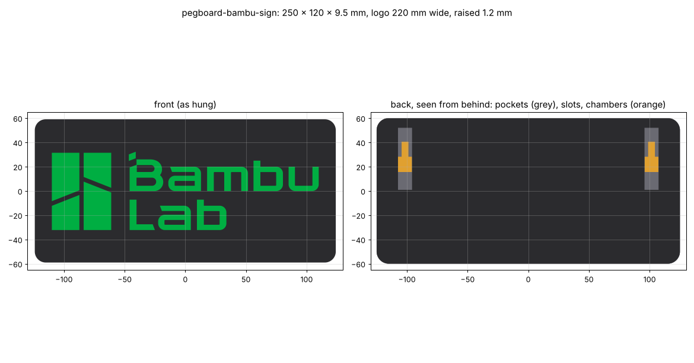

# Pegboard Bambu Lab sign

A flat sign that hangs flush on the pegboard, with the Bambu Lab logo (the four-block mark + "Bambu Lab") raised in the
centre in a second colour. It uses the board's holes to hang. Catalog part: see `docs/pegboard.md`.

## Goal

A wall sign for the printer corner: as big as the A1 can print in one piece, the logo raised in its own colour, and hung
from the pegboard holes (no screws, no tape). It should sit flat and flush, and lift off easily.

## Status

- [x] Logo source: `source/bambulab-logo-2026-11-09.svg` (Wikimedia Commons "File:BambuLab logo.svg")
- [x] v1 (2026-11-09): mark-only logo on a 150 × 150 mm sign. Superseded the same day
- [x] v1.1: owner wanted the "Bambu Lab" text too (like printables.com/model/711282) and the sign as big as the bed allows.
      Now the full logo, 220 × 64 mm, on a **250 × 120 × 9.5 mm** sign. Watertight, 0 self-intersections, Euler 2
- [x] Hangers: 2 × (shared hook + pin + T-stud), 8 holes apart. Checked: clear of the board (0.1 mm per side), the sign
      slides on without hitting them, and pulling it straight off is blocked
- [x] v1.2: owner doubted the pegs could get into the holes. A rock-in simulation (`pb.rock_in`, calibrated on the owner's
      hook prints) agreed: the level 6.1 mm hook jams. The hangers now have a **5.7 mm hook sloped 12°** (since made the shared `PegStyle` default, with 6.1 mm pins) (like the steel hook
      that went in easily) and pass. The build asserts it
- [ ] Owner review: size, colours, anything else on the plate (Open questions)
- [ ] Test print and hang

## How it hangs

Pegs printed straight out of the back of a face-up sign would stand up off the bed and snap at a layer line, and printing the
sign on its side would spread the colour change over every layer. So the pegs are on two small **hangers**, and the sign
hooks onto them, like a keyhole-slot picture frame:

1. Hang both hangers on the board, in the same row, **8 holes apart**: tilt one, push the hook tip up through the upper hole,
   and swing it down until the pin drops into the hole below. Nothing is above them yet, so they rock in on their own.
2. Hold the sign flat on the board ~14 mm higher than where it ends up, so the openings in its back line up with the
   hangers' studs. Push it flat against the board.
3. Slide it down 13.6 mm. The studs' heads move up behind ledges inside the sign, and the sign rests on the studs' necks.
   It sits flush on the board (the hangers are hidden in pockets in its back) and can't come off the front.

To take it down, lift it 14 mm and pull it off.

Where it sits: the sign's top is 12 mm above the hangers' hook holes, its bottom 108 mm below them, and it reaches
26 mm past each hanger's column sideways.

## Measurements

No real measurements needed: the size is the owner's choice and the pegs are the shared ones.

| Feature | Value (mm) | Notes |
|---|---|---|
| Sign | 250 × 120 × 9.5 | `SIGN_W`, `SIGN_H`. 250 is as wide as the A1's 256 bed allows (3 spare per side). 10 corner radius, 1 front chamfer |
| Logo | 220 × 64, raised 1.2 | `LOGO_W`, `LOGO_RAISE` (6 layers at 0.2). Letter strokes 5.5, smallest gaps 3.5 (the mark's slants) |
| Logo changes from the SVG | B's upper counter shrunk 0.25; the B's accent nudged 0.5 off the B | In the SVG both touch at a single point, which makes a non-manifold mesh and a zero-width wall |
| Hanger spacing | 203.2 (8 holes) | `HANGER_COLS` |
| Hanger | 47 × 21 × 11, 3 mm plate | hook + pin 1 in apart, T-stud: neck 5 × 10, head 11 × 12 × 2 |
| Hanger pegs | shared: 5.7 hook sloped 12°, 6.1 pin | `PegStyle` defaults (they rock in, per `pb.rock_in`). The hook's play is fine: the sign's weight seats it and the pins stop it turning |
| Slide-down | 13.6 | `DROP` |
| Sign/hanger clearance | 0.3 per side | `C` |

## Print settings

**Sign** (`output/pegboard-bambu-sign-multicolor.3mf`): face up, back on the bed, as exported. No supports: the hanger pockets
open onto the bed, and the chambers inside are ~12 mm bridges. Open the 3MF in Bambu Studio (if it asks, load it as one
object with multiple parts) and set the filament per part: sign black, logo green. **Only one colour change**, at 9.5 mm:
everything above that is logo, so there's no per-layer purge and no prime-tower churn. Without the AMS: print
`output/pegboard-bambu-sign.stl` and add a filament change (pause) at the first layer above 9.5 mm in the slicer's
layer view. PLA is fine (indoor, light). 2–3 walls, 10–15 % infill. About 285 cm³ solid; roughly 120–150 g at that infill.
It covers most of the bed: use a clean plate and glue stick if PLA lifts at the corners.

**Hangers** (`output/pegboard-bambu-sign-hanger.stl`, **print 2**): on their side as exported, pegs on the bed (layers run
along the pegs), no supports. PETG preferred (the pegs carry the sign); PLA works for a sign this light.

## Open questions

- Colours: black sign + Bambu green logo? (The official logo is dark grey on white; the 3MF lets you pick anything.)
- Anything else on the plate: a raised border in the logo colour, or the sign at a different height?
- The 250 mm sign covers the board 108 mm below the hangers. Does that clear whatever else hangs there?

## Pipeline

`build.py`:
1. Imports the logo SVG (`build123d.import_svg`), rebuilds each shape as a plain polygon face (curves in 0.5 SVG-unit steps),
   fixes the two single-point contacts, scales it to `LOGO_W`, and extrudes it `LOGO_RAISE` off the sign face.
2. Builds the sign plate (rounded corners, front chamfer) in the board frame, flush on the board, and cuts the two hanger
   pockets, the keyhole slots and the chambers the stud heads slide into.
3. Builds the hanger: `pegboard.mount_plate` (one hook + one pin) plus the T-stud, then `pegboard.lay_on_side`.
4. Asserts: the hangers rock onto the board (`pb.rock_in`; their flush overlap is reported, not asserted); the sign slides down onto the studs (9 steps) and pushes on (4 steps) with zero
   overlap; it can't be pulled straight off once hung; it doesn't overlap the board.
5. Writes the 3MF (two parts), STEP + STL (merged), the per-colour STLs, the hanger STEP + STL, `report.json`, renders,
   and the viewer meshes.

## Files

- `output/pegboard-bambu-sign-multicolor.3mf`: print this for two colours
- `output/pegboard-bambu-sign.stl` / `.step`: the sign merged (single colour or manual colour change; STEP for Fusion)
- `output/pegboard-bambu-sign-base.stl`, `-logo.stl`: the two colour bodies
- `output/pegboard-bambu-sign-hanger.stl` / `.step`: the hanger (print 2)
- `output/report.json`: checks, params, board fit, slide-on check
- **Viewer artifact:** https://claude.ai/artifact/4U8kSuKhftWVvXnfHajBFU (publish updates to this URL)

## Log

- **2026-11-09:** v1. Owner wants a sign that hangs flat on the pegboard, Bambu Lab logo raised in a second colour, hung
  from the board's holes. Chose separate peg hangers + keyhole slots so the sign prints face up with one colour change
  and the pegs print the strong way. First cut used the mark alone on a 150 mm square.
- **2026-11-09 (v1.2):** Owner wasn't sure the pegs had room to go into the holes, and suggested moving the hooks up so they
  stick out of the top of the sign. The hangers already go on before the sign, so nothing is above them; the real problem
  was the hook's shape. A new rock-in simulation (`pb.rock_in`, calibrated on the owner's v4/v5 hook prints) showed the
  level 6.1 mm hook jams. Now 5.7 mm with a 12° slope, which passes. The same check fails the fit test and spool holder
  (flagged in `docs/pegboard.md`).
- **2026-11-09 (v1.1):** Owner wanted the "Bambu Lab" text too and the sign as big as the 256 mm bed allows. Now the full
  logo, 220 mm wide, on a 250 × 120 mm sign; hangers 8 holes apart.
