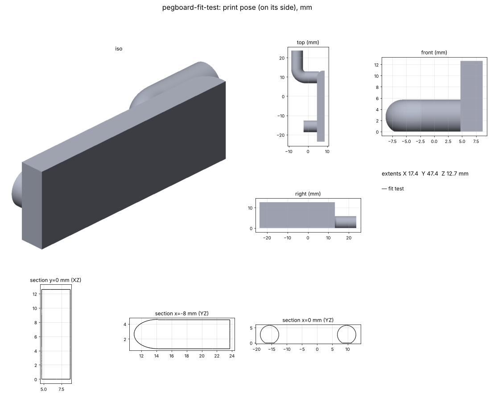

# Pegboard fit test

A small test piece: a 4 mm plate with one shared hook peg and one pin, 1 in apart. It's built only from
`tools/pegboard.py`, so it tests exactly the pegs every catalog part uses. **Print this before any other
catalog part**, and again whenever `PegStyle` or the board changes.

## Goal

Confirm on the real board that the shared pegs go on and come off cleanly and sit snug. Then tune `PegStyle` /
`BOARDS` in `tools/pegboard.py` (one place, so every part follows).

## Status

- [x] Built from the shared interface, watertight, 0 self-intersections
- [x] v1 printed (5.53 mm pegs): hung like the steel hook, but a little loose, and a bit harder to put on because of
      the plate above the hook
- [x] v2: pegs 5.9 mm (~0.2 mm per side in the owner's 6.35 mm holes). The plate stops just above the hook and its top
      back edge is rounded (R ≈ 3 mm) so it rocks in. 47.4 × 17.4 × 12.7 mm. Clears the board with 0.2 mm per side to spare
- [x] v2 printed: easier to put on with the rounded plate top; the 5.9 mm pegs still loose
- [x] v3: pegs 6.1 mm, plus a **peg gauge** (`output/pegboard-peg-gauge.stl`): a strip of straight pins at 6.0 / 6.1 / 6.2 / 6.3 / 6.4 mm,
      each labelled, spaced off-grid so each pin is tried in a hole on its own
- [ ] Owner tries the gauge: which is the snuggest pin that still goes in by hand? That becomes `PegStyle.d`
- [ ] Caliper the board thickness (still the listing's 3.94 mm)

## Measurements

The pegs come from the steel hook (`projects/pegboard-hook`): 7.3 mm clear behind the front face, leg rising 14 mm above the
hole centre, 4.5 mm bend radius, 7 mm pin. The diameter is 6.1 mm, up from the steel wire's 5.53, after prints at 5.53 and 5.9 were both loose. The gauge will settle it.
Fit checks keep 0.1 mm per side (`FIT_CLEARANCE`). The owner's prints come out loose, not fat.

| Feature | Value (mm) | Source |
|---|---|---|
| Board | Menards "3/16 x 4 x 8 White Pegboard Panel" | owner, 2026-11-05 |
| Hole spacing | 25.4 (1 in) | owner measured, 2026-11-05 |
| Hole diameter | 6.35 (~0.25 in) | owner measured, 2026-11-05 (listings had said 9/32 in) |
| Thickness | 3.94 (0.155 in) | retailer listings, not measured yet |

## Print settings

Both pieces: PETG, on their side (pegs flat on the bed, 0.4 mm flat), no supports. About 15–20 minutes each.
Print the gauge with the same filament and settings as the real parts, because that's what it calibrates.

## Pipeline

`build.py` builds `pegboard.mount_plate(PegStyle(), cols=(0,), rows=(0, 1), thickness=4)` with the plate's lower edge flush
with the pegs, lays it on its side (`pegboard.lay_on_side`), exports the STEP and STL, and asserts zero overlap with the board.

## Files

- `output/pegboard-fit-test.stl`: print this
- `output/pegboard-fit-test.step`: editable solid for Fusion
- `output/pegboard-peg-gauge.stl` / `.step`: peg gauge (print on its side, no supports, ~20 min)
- `output/report.json`: checks, peg style, board fit
- **Viewer artifact:** https://claude.ai/artifact/UwaRj3ht4BSYQHvKqeFPXS (publish updates to this URL)

## Log

- **2026-11-05:** Split out of `pegboard-hook` into its own project, as the check for the shared pegboard interface.
- **2026-11-05:** The owner's board is a Menards 3/16 in white hardboard panel. Added it as `pegboard.DEFAULT_BOARD`
  (listing values 7.14 mm holes, 3.94 mm thick), and fit checks now leave 0.2 mm per side. The fit test clears it.
- **2026-11-05 (v2):** The owner printed v1: it worked like the steel hook, but was a little loose, and the plate above the hook made it a bit
  harder to put on. The owner measured the holes at ~0.25 in on 1 in centres, so the board is now 6.35 mm holes. Shared pegs went
  from 5.53 to 5.9 mm. `mount_plate` now stops just above the hook and rounds the plate's top back edge.
- **2026-11-05 (v3):** The owner printed v2: easier to put on, but the 5.9 mm pegs were still loose. Pegs went to 6.1 mm,
  `FIT_CLEARANCE` went from 0.2 to 0.1 mm, and the peg gauge (6.0–6.4 mm) was added to find the right diameter in one print.
