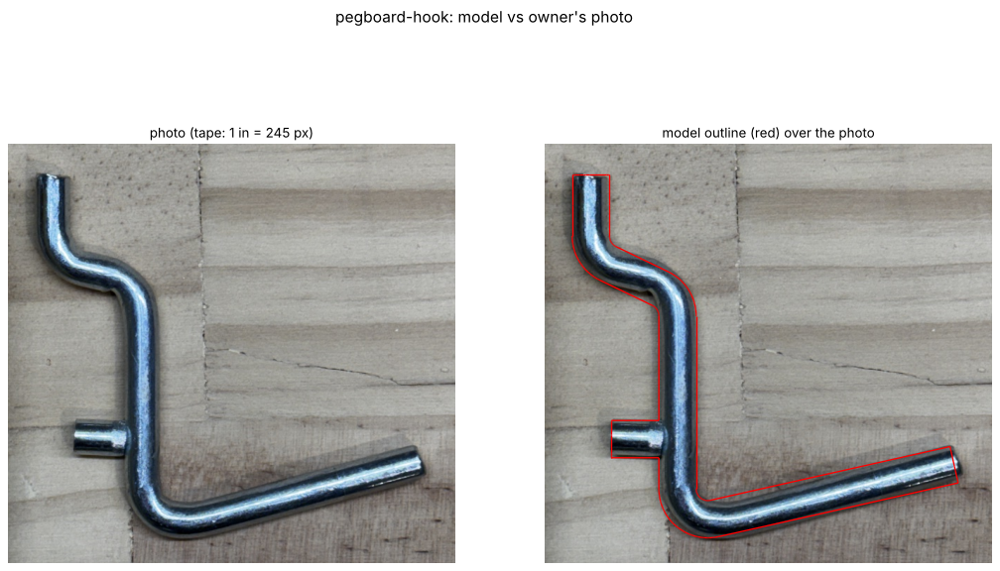

# Pegboard hook

A standard steel pegboard hook: one bent 5.53 mm wire (a short leg that goes through
the board and rises behind it, an S-jog, a back leg against the board, and an arm that
angles up) plus a short welded pin that sits in the hole below and stops it rotating out.

## Goal

**A baseline for custom pegboard parts** (owner, 2026-11-05). The hook itself matters less than the
board interface it proves: hole grid, peg size, and how a hook goes through and hooks behind. That interface now
lives in shared tooling, **`tools/pegboard.py`** (see `docs/pegboard.md`). Its `PegStyle` defaults are this
hook's measurements. This project keeps the measured steel-hook replica as the reference and builds a small
**fit-test piece** from the shared interface, to print and validate it on the real board.

## Status

- [x] Source captured: three photos with tape and caliper (`source/photo-2026-11-05-*.jpg`)
- [x] Real measurements recorded (below)
- [x] Parametric model (`model.py`, build123d), traced from the tape photo. The outline overlays
      the photo within about 1 mm (`renders/photo-overlay.png`)
- [x] Print-ready STL + STEP: lying on its side, 0.4 mm flat on the bed side. 57.2 × 53.9 × 5.1 mm,
      watertight, 0 self-intersections
- [x] Shared interface extracted: `tools/pegboard.py` (board frame, `hook_peg`, `pin_peg`, `mount_plate`,
      board mesh + interference check, print pose) and `docs/pegboard.md`
- [x] Fit-test piece (`output/pegboard-fit-test.stl`): 4 mm plate, one hook + one pin 1 in apart, prints on its side
      with no supports. 0 mm³ interference with a nominal 1/4" board
- [ ] **Print the fit test** (PETG) and hang it on the real board: snug, loose, or tight? Then tune `PegStyle`
- [ ] Caliper the real board (hole diameter, thickness) and add it to `pegboard.BOARDS` as the default

## Measurements

| Feature | Real (mm) | Source | Notes |
|---|---|---|---|
| Wire diameter | **5.53** | caliper | Pin looks like the same wire (~5.5 mm in the photo) |
| Overall (footprint × height) | 57.2 × 53.9 | tape photo | Photo reads ~57.9 × 53.9 (tip edge to arm end, top to bottom bend) |
| Arm | 42.0 long, 12.6° up | tape photo | Reaches 43.8 mm out from the board face |
| Behind-board leg | 12 mm tall, centre 12.85 behind the back leg | tape photo | Leaves 7.3 mm for the board |
| S-jog | ~26° slope | tape photo | Least certain part (it's curved) |
| Pin | 13.0 above the bottom corner, sticks out 7.0 | tape photo | |
| Bend radius | 4.5 (centreline) | estimated | One radius for every bend |

Photo scale: `photo-2026-11-05-tape-vertical.jpg`, tape inch marks 245 px apart (9.65 px/mm). The model
origin (bottom corner of the wire centreline) is at pixel (750, 1308). Both are in `build.py`, and the
overlay render uses them. Positions are good to about ±1 mm.

## Print settings

- **PETG** (default for load-bearing). Lying flat on its side, no supports. The 0.4 mm flat gives a 3.1 mm wide first layer.
  A brim may help, since the contact patch is thin.
- At 5.5 mm the wire is all perimeters, so infill doesn't matter. Plastic this thin is far weaker
  and more flexible than steel. Fine for light things (keys, cables, small tools). It will bend under heavy ones.

## Open questions

- **Board thickness and hole size.** On a nominal 1/4" board (6.35 mm holes, 6.35 mm thick), the
  model's S-jog clips the hole edges slightly (~42 mm³ overlap in the check). The real hook's
  jog seems to as well in the photo. Real boards often have bigger holes or are thinner. The shared
  `hook_peg` avoids this, because it goes straight through the hole (no slope). A caliper reading of the hole and board would settle it.
- The pin's ~1 in (24 mm in the photo) spacing from the jog: does the real hook sit tight or a little loose?

## Pipeline

`build.py` makes two things. The **steel-hook replica** is described below. The **fit test** is
`pegboard.mount_plate(PegStyle(), cols=(0,), rows=(0, 1))`, laid on its side with `pegboard.lay_on_side`. Both are checked
hung on `pegboard.board_mesh(BOARDS["quarter"])` in the shared board frame (`model.use_to_board` moves the replica there).

Replica: `build.py` builds the hook in the use frame (`model.py`: a circle swept along a filleted polyline,
plus a cylinder for the pin), lays it on its side and shaves the bed flat (`print_pose`), and exports
the STEP and STL. It also checks the hook against a 1/4" pegboard patch, renders previews, and draws
the model outline over the photo. Parameters are in `HookParams` (`model.py`). Real measurements go in
`MEASURED` in `build.py`.

## Files

- `output/pegboard-hook.stl`: print this (Bambu Studio)
- `output/pegboard-hook.step`: editable solid for Fusion
- `output/pegboard-fit-test.stl` / `.step`: fit-test piece from the shared interface, so print this first
- `output/report.json`: checks + parameters (including `fit_on_board` interference)
- `renders/photo-overlay.png`: model vs photo; `renders/model.png`, `renders/fit-test.png`: views + sections
- **Viewer artifact:** https://claude.ai/artifact/S5AyTFWVq79VooqWJUmkQr (publish updates to this URL)

## Log

- **2026-11-05:** Project started from three owner photos (tape + caliper, wire 5.53 mm). Traced the wire
  path and pin off the tape photo and built a parametric sweep in build123d. Outline matches the photo within ~1 mm.
  Printable version lies on its side with a 0.4 mm flat. Published the viewer. Waiting on the owner: intended use, and board
  thickness/hole size (the jog clips a nominal 1/4" hole slightly).
- **2026-11-05 (v2):** The owner wants this as a baseline for future custom pegboard parts. Extracted the board interface into
  `tools/pegboard.py` + `docs/pegboard.md`, with peg defaults from this hook (5.53 mm, 7.3 mm gap behind the board, 14 mm rise, 7 mm pin).
  Added the fit-test piece (0 interference on a nominal 1/4" board). Next: the owner prints the fit test and calipers the board.
