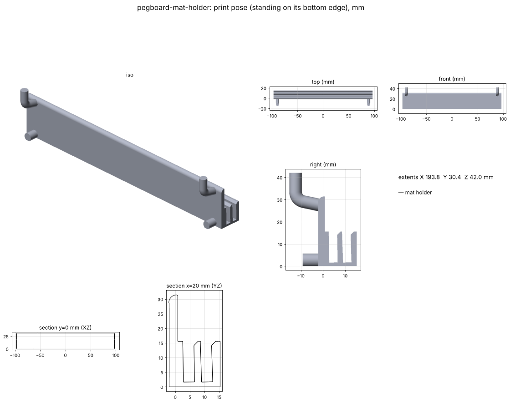

# Pegboard cutting-mat holder

A thin strip that hangs on the pegboard behind the printers and holds the owner's two ZenBeya self-healing cutting mats
(A3 + A4) upright in slots, leaning back against the board like the product photo. One piece with the pegs.
Catalog part: see `docs/pegboard.md`.

## Goal

Keep both mats stored flat against the board, out of the way, as thin (out from the board) as possible. One printed
piece, shared pegs.

## Status

- [x] v0.1 concept (2026-11-11): 194 × 17 mm strip, 2 slots, 2 hooks (row 1) + 2 pins (row 0) in columns 0 and 7.
      Watertight, Euler 2, 0 self-intersections; rock-in passes. A3 leans ~1°, A4 ~1.8°
- [x] Owner review (2026-11-11): near-upright lean OK, landscape OK. Owner picks the holes behind the printers
- [x] Mat thickness by calipers: 2.5–3.0 mm. Slots tightened from 3.8 to 3.5 mm (v0.2)
- [ ] Test print and hang

## Measurements

| Feature | Value (mm) | Notes |
|---|---|---|
| A3 mat | 450 × 300 × 2.5–3.0 | listing size; thickness by owner's calipers (varies across the mat) |
| A4 mat | 300 × 220 × 2.5–3.0 | assumed same as the A3 |
| Holder | 194 wide × 17.4 deep, slot block 16 high, plate 31.8 high | `holder_*` in report.json |
| Slots | 3.5 wide (3.0 thickest + 0.5), 14 deep, tilted to each mat's lean | `SLOT_CLEAR`, `SLOT_DEPTH` |

## How it works

A mat leans back until its top edge touches the board, so its lean is set by how far its bottom sits from the board:
sin(lean) = distance / height. Keeping the holder thin means near-upright mats; the 14 mm deep slots are what hold them.
Each extra degree of A3 lean costs ~5 mm of depth (`A3_GAP`). The A4 in the front slot leans on the A3's face. Both slots
are tilted to the mat's natural lean and run the full length (open ends), with a lead-in chamfer on their front mouths.

## Print settings

`output/pegboard-mat-holder.stl`: standing on its bottom edge as exported (slots open up, pins on the bed with a 0.4 mm
flat, layers along the pegs). Supports only under the 2 hooks (tree, on build plate only). PETG.

## Open questions

- None open. Placement behind the printers is the owner's call (it stands about 17 mm out, plus the mats' 3 mm,
  so it must clear the A1's bed travel). If a slot is tight on the test print, raise `SLOT_CLEAR` to 0.6–0.7.

## Files

- `build.py`: the whole pipeline. `output/`: STEP + STL + report.json. `renders/`: PNG, viewer meshes, `viewer.html`
- Review page (publish updates to this URL): https://claude.ai/artifact/4VNtMDZxqtqP9Xp9fVX5z6

## Log

- **2026-11-11:** v0.1 concept from the owner's request (mats ~3 mm, thin, one piece, horizontal slots, lean on the board).
- **2026-11-11:** v0.2: owner calipered the mats at 2.5–3.0 mm. Slot = 3.0 + 0.5 = 3.5 mm (was 3.8); the holder is ~0.6 mm thinner.
- **2026-11-11:** Owner approved v0.2: near-upright lean (A3 ~1°, A4 ~1.7°) and landscape mats. Owner handles placement. Next: test print.
