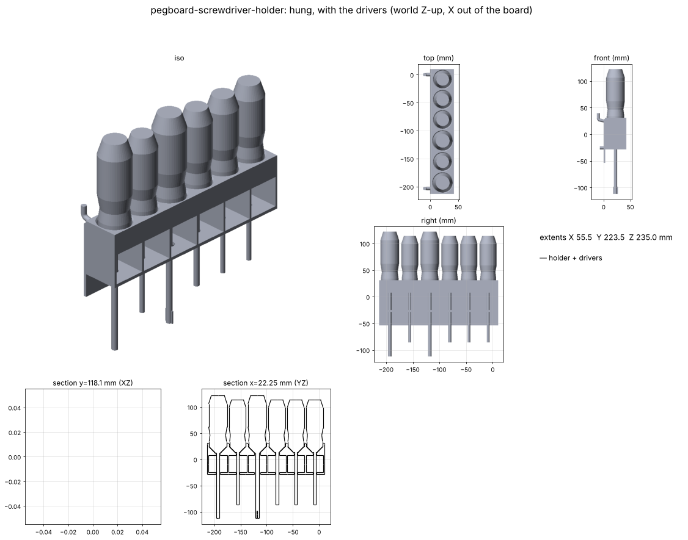

# Pegboard screwdriver holder

Holds the owner's 6 Ryobi screwdrivers upright on the pegboard so they can't tip, replacing a steel rack of wire rings.
Catalog part: see `docs/pegboard.md`.

## Goal

The steel rack (`source/2026-11-14-current-holder-*.jpg`) holds each driver in one loose wire ring, so it pivots on
it and leans or tips. Hold each driver at **two heights** instead, so it stays straight, in one printed piece on the
shared pegs.

## Status

- [x] v0.1 concept (2026-11-14): 223.5 × 42.5 × 59.5 mm, 6 cups + 6 guide holes, 2 hooks (row 1) + 2 pins (row -1),
      columns 0 and 8. Watertight, 0 self-intersections (Euler -22: each station's 2 holes open into the front bays); rock-in passes
- [ ] **Owner measures the handles** (see Open questions). Handle/bolster sizes are estimates until then
- [ ] Owner review of the concept
- [ ] Test print one station, check the cup fit, then the full holder

## Measurements

| Feature | Real (mm) | Notes |
|---|---|---|
| Small slotted shaft | 5.03 | calipers, 2026-11-14 (`source/…-small-shaft-5.03.jpg`) |
| Large slotted shaft | 6.43 | calipers (`…-large-shaft-6.43.jpg`) |
| Large slotted blade width | 9.58 | calipers (`…-large-blade-9.58.jpg`). Sets that station's holes: the tip has to pass through |
| Handle grip width | **~32 small / ~35 large (est)** | from photos. Sets the spacing |
| Bolster (yellow collar) width | **~30 small / ~33 large (est)** | from photos. Sets the cups |
| Other shafts / tips | est | see `TOOLS` in `build.py` |

Order left to right (as on the board now): slotted small, slotted small, slotted medium, **slotted large**,
Phillips #1, **Phillips #2** (bold = the two bigger handles).

## How it works

- **Cup** (top shelf): the bolster drops into a pocket 1.5 mm wider than it, with 7 mm of straight wall and a 45° cone
  floor that self-centres the bolster's tapered bottom. 1.5 mm lead-in chamfer at the mouth.
- **Guide hole** (bottom shelf), 50.8 mm below: the shaft passes through. Hole = max(shaft, tip) + 1.5 mm.
- Worst-case lean = atan((hole play + cup play) / span): ~1.7° for most, 3.5° for the large slotted (its hole must pass
  the 9.6 mm blade). The wire rack allows far more.
- Open front bays between ribs, so you can see the shafts. Drop drivers in tip first.

## Print settings

`output/pegboard-screwdriver-holder.stl`, standing as it hangs (cups up, bottom shelf + pins on the bed, 0.4 mm flat).
Supports only under the 2 hooks (tree, build plate only). PETG. ~229 cm³ solid volume, so normal sparse infill.
Target either printer (A1 fine, it's indoor and light).

## Open questions

- **Handle sizes**, for each driver: (1) widest grip width, (2) widest bolster (yellow collar) width, and (3) a side
  photo of the bolster next to a ruler, so the cup cone matches its taper. Also the blade width of the other slotted drivers.
- Fixed order left to right as now, or any order? (Fixed lets each cup fit its own driver.)
- Where it hangs: same holes as the steel rack?

## Pipeline

`build.py`: `TOOLS` (one row per driver) → layout (spacing from grip widths, 4 mm gap), cups from bolster widths,
holes from shaft/tip. Peg columns picked as far apart as the width allows. Asserts: watertight, rock-in, no driver
hits the holder, neighbouring handles don't touch, ≤ 250 mm wide.

## Files

- `build.py`: the whole pipeline. `source/`: owner's photos. `output/`: STEP + STL + report.json.
  `renders/`: PNGs, viewer meshes, `viewer.html`
- Review page (publish updates to this URL): https://claude.ai/artifact/NngHxZQWjnb5JfRtNp3V4V

## Log

- **2026-11-14:** v0.1 concept from the owner's photos and 3 caliper readings: two-point support (bolster cup + shaft
  guide hole 50.8 mm apart), rows -1/1 so the span is 2 holes. Handle sizes estimated; asked the owner to measure.
