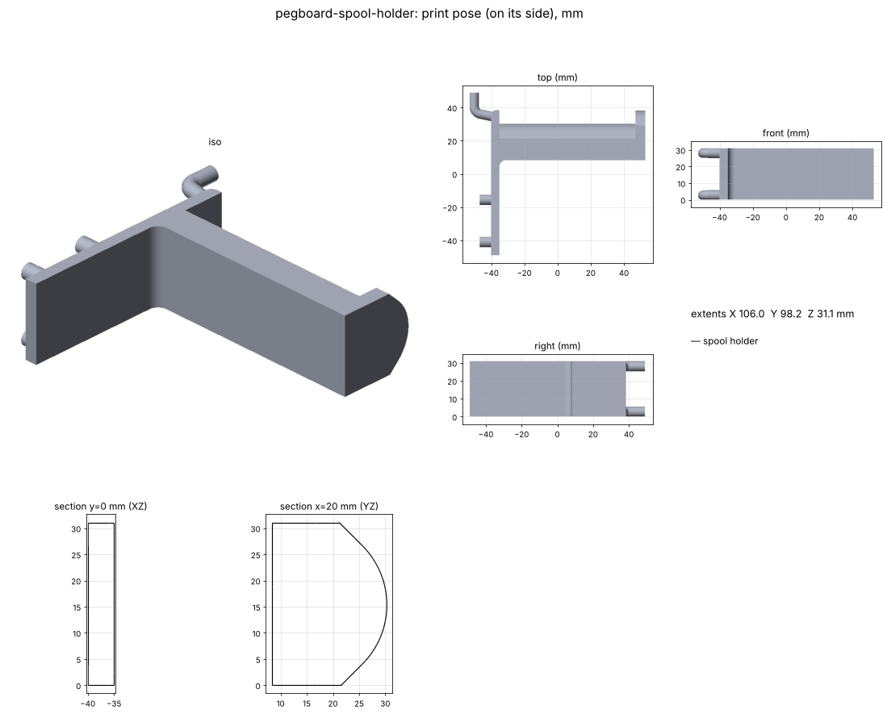

# Pegboard spool holder

Holds the A1's active spool on the pegboard behind the printer, instead of on the printer's own spool holder.
The spool hangs "sideways": a straight arm sticks out of the board and the spool sits on it with its face parallel to the
board, like a paper-towel holder. Catalog part: see `docs/pegboard.md`.

## Goal

A spool holder that hangs on the shared pegs (two hooks + four pins), takes any normal 1 kg spool, and is strong enough to carry it full.

## Status

- [x] v1 designed: one column of shared pegs (hook in a hole, pin 2 holes / 2 in below), 5 mm plate, 22 × 26 mm arm with
      45° chamfered top edges (the spool turns on the 10 mm flat between them), 82 mm of reach, 8 mm end lip.
      106 × 73 × 22 mm print, watertight, 0 self-intersections, clears the board (0.1 mm per side)
- [x] Spool checks: arm + lip pass through a 50 mm bore; spools up to 82 mm wide fit; the reference 200 × 68 mm spool
      (53 mm bore) clears the arm and board
- [x] v2 (owner: "multiple hooks"): **two hooks side by side** in one row (1 in apart) + two pins 2 in below. Side by side,
      not stacked: two hooks share one rocking axis, so they go in together (stacked hooks would swing on different arcs and bind).
      The arm widened to 31.5 mm to span both columns, so it stays on the bed and centred under the load; arm height 26 → 22 mm.
      106 × 73 × 31 mm print, watertight, clears the board; arm + lip still pass a 50 mm bore
- [x] v3 (owner: taller span + more pins): hooks now in row 3, **3 in above the bottom pins** (was 2 in: a 50 % longer lever
      against pull-out), plus a **second pin row** 2 in below the hooks. 6 holes total (2 hooks + 4 pins). Arm stays just under
      the hooks. 106 × 98 × 31 mm print, watertight, clears the board
- [x] v4 (owner: round the top): the arm's top is a **16 mm radius crown** instead of a flat between two chamfers. The spool's
      hole used to rest on the two flat/chamfer corners; now it rides on one smooth line along the top. The arc spans ±45° and
      blends into 45° chamfers, so the bed side still prints without support
- [x] v5 (2026-11-09): both hooks are now the shared 5.7 mm hook sloped 12°, so it rocks in (`pb.rock_in`); pins stay 6.1
- [ ] Owner review: where it hangs behind the A1, filament path, fixed arm vs spinning hub (Open questions)
- [ ] Test print and hang with a full spool

## Measurements

| Feature | Value (mm) | Source |
|---|---|---|
| Reference spool | 200 OD × 68 wide, 53 bore | typical 1 kg spool (Bambu); not measured yet |
| Spool bores handled | ≥ 50 | design limit (`MIN_BORE`) |
| Widest spool | 82 | `ARM_REACH` |
| Board | Menards 3/16 in white, 6.35 holes, 1 in grid | `pegboard.DEFAULT_BOARD` |

Where a 200 mm spool ends up, relative to the hook holes: centre 29 below, bottom 129 below, top 71 above;
centre 40 out from the board, front face 74 out. The arm tip is 93 mm out from the board.

## Print settings

PETG (it carries ~1.2 kg all the time, and PLA creeps). On its side as exported, so the layers run along the pegs and the arm.
One column of pegs and the arm lie on the bed; the other column's hook and 2 pins are 25 mm up and **need supports**
(tree, on build plate only; the arm's rounded top meets 45° chamfers, so its bed side needs none). 4 walls, 20–30 % gyroid.
About 75 cm³ solid, roughly 65–75 g at that infill.

## Open questions

- **Where does it hang behind the A1?** The A1's bed slides toward the board, and the spool stands 74 mm out from it, so the
  spool must sit above or beside the bed's travel. Which hole should the hook go in?
- **Filament path:** does the filament reach the A1's PTFE tube / runout sensor from there, or should I add a tube guide
  or clip?
- **Drag:** the arm is fixed (the spool's bore turns on the rounded top, PETG on plastic). If the drag is too much, a later version could add
  a spinning hub on two 608 bearings.
- Measure the real spools (Overture, etc.): outside diameter, width and bore.

## Pipeline

`build.py` builds `pegboard.mount_plate(PegStyle(), cols=(0, 1), rows=(0, 3), thickness=5)` plus a row of `pin_peg`s at row 1 with its bed-side edge flush
with the pegs, adds the arm and lip, lays it on its side (`pegboard.lay_on_side`), exports the STEP and STL, and asserts:
zero overlap with the board, the arm + lip pass through a 50 mm bore, and the reference spool clears the arm and board.
Parameters at the top of `build.py` (`ARM_*`, `CROWN_R`, `LIP_*`, `ROWS`, `EXTRA_PIN_ROWS`, `COLS`, `SPOOL`).

## Files

- `output/pegboard-spool-holder.stl`: print this
- `output/pegboard-spool-holder.step`: editable solid for Fusion
- `output/report.json`: checks, params, board fit, spool fit
- **Viewer artifact:** https://claude.ai/artifact/7qNGasQkhXUMmqVtrSyc8Q (publish updates to this URL)

## Log

- **2026-11-08:** v1. The owner wants the A1's active spool on the pegboard behind the printer, held sideways. One peg column
  (hook + pin 2 in apart) so it prints on its side with every peg on the bed; a fixed arm with a chamfered top and an end lip.
- **2026-11-08 (v2):** Owner wanted multiple hooks. Now two hook columns 1 in apart (same row, so they rock in together) + two
  pins. Arm spans both columns (31.5 mm wide, 22 mm tall). Costs supports under the second column's pegs when printed on its side.
- **2026-11-08 (v3):** Owner asked whether hooks 3 in apart would be stronger. Answer: little gain (the load is centred, so each
  hook carries half either way, and pull-out depends on the vertical span), with taller supports and a T-shaped plate. Did the
  alternatives instead: hook-to-bottom-pin span 2 → 3 in, and a second pin row (row 1). Hooks stay 1 in apart.
- **2026-11-08 (v4):** Owner asked to round the top. Arm top is now a 16 mm crown (tighter than any spool bore) blending into
  45° chamfers, built as an extruded profile (`arm_section`). The lip uses the same profile, 8 mm taller.
- **2026-11-09:** v5: the owner noticed the sign's level hooks might not go into the holes. A new rock-in check
  (`pb.rock_in`, calibrated on the owner's v4/v5 hook prints) showed the shared level 6.1 mm hook jams. The shared `PegStyle` now
  has a 5.7 mm hook sloped 12° and keeps 6.1 mm pins; both hooks follow. The build asserts the rock-in check (the flush overlap is now info only).
