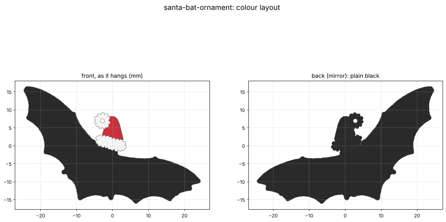

# Santa-hat bat ornament

A flat, hanging Christmas ornament: the paper bat wearing a Santa hat from the owner's wall of
Halloween bats, made printable. It's 50 mm wing tip to wing tip: a 2 mm black bat with the red hat and white trim layered on top (like the paper one). It hangs from a tiny hole through the pom-pom.

## Goal

A mostly flat ornament (owner: "a little thickness but not much") that looks like the paper bat with the
Santa hat. Owner's picks: **50 mm across, three colours** (AMS lite: black, red, white).

## Status

- [x] Source captured: `source/photo-2026-11-09-wall-bats.jpg` (the bat with the Santa hat is right of centre)
- [x] Bat outline traced from the photo; hat drawn by hand over it (`renders/photo-trace.png`)
- [x] v1: 99.6 × 65.2 mm, 3 mm thick (3.6 mm at the brim and pom-pom), 3.2 mm hanging hole. Watertight, 0 self-intersections,
      Euler 0 (one through-hole, as intended)
- [x] v2: owner didn't like the hole through the pom-pom. The pom-pom is solid again, with a slim black hanging loop on top
- [x] v3: owner picked 50 mm and three colours. 2.4 mm thick, pom-pom and loop resized for the small scale
- [x] v4: owner chose less waste. Black base + colour layers on top, so all AMS swaps are in the top 4 layers
- [x] v5: owner still unsure about the ring. Now a tiny 1.8 mm hole in the black wing. It can't hang level (see Measurements); the owner chose the tilt
- [x] v6: owner went back to a hole through the pom-pom, "as small as possible": 1.2 mm
- [x] v7: fuzzy white trim, a bumpy cloud-like edge on the brim + pom-pom (`fuzz()` in `build.py`)
- [ ] Owner review of v7
- [ ] Test print

## Measurements

No real measurements: the size is the owner's choice (`ORNAMENT_SIZE_MM = 50`, wing tip to wing tip with the wings level).

| Feature | Value (mm) | Notes |
|---|---|---|
| Overall (as it hangs) | 49.1 × 32.6 | Hangs within 1° of wings-level |
| Thickness | 2.0 black base; 2.6 at the red hat; 2.8 at the brim + pom-pom | Red 0.6 (3 layers) so the black doesn't darken it; white 0.8 (4 layers), 0.2 proud of the red like fur |
| Pom-pom | 4.4 dia (over the fur bumps) | True scale would be ~3.3. Leaves 1.2 mm around the hole at the deepest fur valley. Overlaps the hat along ~3.4 mm |
| Fur edge (brim + pom-pom) | bumps r 0.42–0.58, ~1.0 apart, from a core inset 0.4 | `FUZZ_*`. Random, seeded, so builds repeat. Red cusps thinner than 0.4 between bumps are dropped (black base shows) |
| Hanging hole | 1.2 dia, through the pom-pom | The smallest that stays open with a 0.4 nozzle (prints ~1.0). Earlier tries: 3.2 mm through the pom-pom (v1), a ring on top (v2–v4), a 1.8 mm hole in the wing (v5, which hung tilted ~43°) |
| Smallest feature | 1.2 | Wing-claw spikes thinner than this are dropped. At 50 mm that's nearly all of them |
| Thinnest colour region | ≥ 0.4 | No unprintable colour slivers |
| Colour swaps | ~5 | Only in layers 11–14. Black layers 1–10 print in one go |

**Perspective:** the photo looks along the wall from the left, so the bat is squashed sideways. The pom-pom (a
hand-cut circle) reads 0.81 wide/tall, so X is stretched 1.23× (`PERSPECTIVE_X_STRETCH`). This is an estimate. A
straight-on photo of the paper bat (or one with a ruler beside it) would settle it.

## Print settings

- **PLA** (indoor, decorative). Flat on the bed, black face down, no supports. 0.2 mm layers (14 at the trim).
- **AMS lite:** open `output/santa-bat-ornament-multicolor.3mf` (if Bambu Studio asks, load it as one object with multiple parts)
  and set the filament for each part: bat (base) black, hat red, trim white. Layers 1–10 are all black; the colour
  changes are only in layers 11–14 (~5 swaps), so the prime tower is short and the purge waste small. Several on one plate
  share those swaps.
- **White:** matte white PLA makes the fur look softer. For real fuzz, brush on white glue and sprinkle white flocking powder.
- **One colour:** `output/santa-bat-ornament.stl`. The raised hat shows as relief; paint it if you like.
- Thread fishing line, sewing thread, or fine wire through the pom-pom (the hole prints ~1 mm; a needle opens it if it's tight). The renders show it as it hangs.

## Open questions

- Does the 1.2 mm hole stay open in print? If it closes, ream it with a needle, or go to 1.4 mm.
- Does the bat look right, especially its width after the perspective stretch?

## Pipeline

`build.py`:
1. Thresholds the dark paper (grey < 110) in a crop around the bat, keeps the largest blob, and traces its contour.
2. Builds the hat from polygons hand-traced on a 5× zoom of the photo (`_HAT_ZOOM`). The white paper is too
   close to the wall colour to threshold.
3. Flips to Y-up, applies the perspective stretch, rotates so the centroid hangs straight below the pom-pom,
   and scales to `ORNAMENT_SIZE_MM`.
4. Drops sub-`MIN_FEATURE` spikes, sizes the pom-pom, and splits the outline into bat, hat, and trim regions. Gives the brim and pom-pom a fur edge (`fuzz()`:
   an inset core plus random round bumps along its edge). Cuts the `HANG_HOLE_D` hole through
   the pom-pom centre (base + white layer), then turns everything so the balance point (volume-weighted) hangs straight below it.
5. Extrudes the black base (whole outline) to `THICKNESS`, then the hat (`HAT_LAYER`) and trim (`TRIM_LAYER`) on top of it. Merges them into a
   single-colour STL (manifold3d), and writes the 3MF, SVG, report, and renders.

## Files

- `output/santa-bat-ornament.stl`: single-colour print
- `output/santa-bat-ornament-multicolor.3mf`: one object, three parts (bat / hat / trim) for the AMS lite
- `output/santa-bat-ornament-{bat,hat,trim}.stl`: the colour bodies on their own
- `output/santa-bat-ornament-outline.svg`: coloured outline at 1:1 mm (Fusion import, cutting more paper bats)
- `output/report.json`: checks + parameters
- `renders/photo-trace.png`: trace over the photo; `renders/layout.png`: front/back colours; `renders/model.png`: views + sections
- **Viewer artifact:** https://claude.ai/artifact/AnvmvzdQsUKBGzz1mdb5W5 (publish updates to this URL)

## Log

- **2026-11-09:** Project started from the owner's wall photo. Traced the bat, drew the hat by hand, and corrected the sideways squash
  (1.23×, estimated). v1: 100 mm, 3 mm thick, a hanging hole through an enlarged pom-pom, three colour bodies + a merged
  single-colour STL. Waiting on the owner for size, colour plan, and shape feedback.
- **2026-11-09:** Owner: the hat was in the wrong place in the 3D viewer. That was a viewer-only bug: each colour body was lifted
  to the floor separately, so the hat and trim dropped below where they belong. Fixed with one shared offset. The print files were
  unaffected (the layout and STL were already right).
- **2026-11-09:** v2. The owner wasn't keen on the hole through the pom-pom. Now the pom-pom is a solid 7 mm ball, with a slim black loop on top (5 mm across, 2.6 mm hole), like a glass ornament's cap. A same-size white loop looked like a snowman, so it's smaller and black. Watertight, 0 self-intersections, Euler 0 (the loop's hole).
- **2026-11-09:** v3. Owner: 50 mm, three colours. Thickness 3 → 2.4 mm (fur 0.4 proud) to stay in proportion and cut colour swaps. Pom-pom 4.5 mm, loop 4 mm with a 2 mm hole (smallest that still takes a hook). All colour regions ≥ 0.4 mm wide. Watertight, 0 self-intersections.
- **2026-11-09:** v4. The owner wants less waste. Colours no longer go through the full thickness (~25 AMS swaps). Now it's a black 2 mm base (whole outline + loop) with a red hat 0.6 mm and white trim 0.8 mm layered on top: ~5 swaps, all in layers 11–14. The back is plain black. Watertight, 0 self-intersections.
- **2026-11-09:** v5. The owner was still unsure about the ring. Offered a tiny hole in the black, but the balance point sits under the hat brim, so a black-only hole can't hang level (least tilt ~43°, on the upper wing). Showed options (wing hole tilted / brim hole level / glued thread); the owner chose the wing hole. 1.8 mm hole, the pom-pom back to a solid 4 mm, size now defined as a 50 mm wingspan. Watertight, 0 self-intersections, Euler 0.
- **2026-11-09:** v6. The owner went back to a hole through the pom-pom, "as small as possible": 1.2 mm (the smallest that reliably stays open), 1.4 mm wall in the 4 mm pom-pom. Hangs within 1° of wings-level. Watertight, 0 self-intersections, Euler 0.
- **2026-11-09:** v7. The owner asked for fuzzy-looking white parts. Discussed options (model edge, textured top, Bambu fuzzy skin, flocking); the owner picked a bumpy fur edge in the model. Brim + pom-pom get random round bumps (~1 mm pitch, 0.4–0.6 mm). Pom-pom 4.4 mm. Red cusps under 0.4 mm dropped. Base and merged STL now use the full hat shape so they stay clean (Euler 0, watertight, 0 self-intersections).
