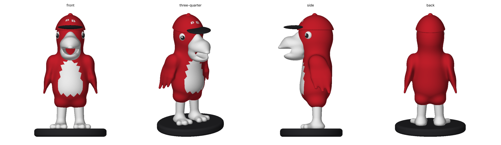

# Thunderbird mascot figurine

A small standing figurine of the Black Bob Elementary Thunderbird costume mascot. Multicolour for the AMS: red,
white, black.

## Goal

A desk or shelf figurine that clearly reads as *our* Thunderbird. It's a chibi interpretation built in code, not a
scan, so the shapes are clean and easy to change by parameter. It's a sibling of `projects/black-bob-keychain` (the logo).

## Status

- [x] Source: `source/costume-photo-2026-11-14-instagram.png` (owner's screenshot of the school's Instagram post)
- [x] v1: chibi figure on a black base, 80 mm tall, 3 colours. Watertight, 0 self-intersections, colour bodies disjoint
- [x] Owner review of v1: "too pudgy and bloated", and wants smaller feet (even though the costume's are huge)
- [x] v2: slimmer torso, head, wings and legs; feet ~40% smaller; base 49 × 43
- [x] Owner review of v2: arms should be more wing-like, the beak more angular
- [x] v3: flat swept wing blades with three primary feathers; faceted beak (ridge, flat faces, sharp hook)
- [x] Owner review of v3: beak too blocky; make it big like the costume's
- [x] v4: big lofted beak (rounded sections, deep hook, open mouth)
- [x] Owner review of v4: the upper and lower beak join at the back on the costume; the head is too round
- [x] v5: one-piece beak (halves blended at the gape), pear-shaped head (cranium + cheeks), white face plate under the cap
- [x] Owner review of v5: "perhaps referencing our Black Bob Elementary keychain model image will help"
- [x] v6: from the logo: chest lightning bolt, logo beak (long, hooked, open grin, gape under the eye), smaller head, black cap bill, crest feathers
- [x] Owner review of v6: "not going well". Owner sent six more costume photos (`source/costume-2026-11-14-facebook-*.png`)
- [x] v7: rebuilt from the costume photos (see Design notes); v1-v6 history is in the Log
- [x] Owner review of v7: "def the closest the beak has been", but looks surprised, not smiling
- [x] v8: mouth reshaped into a grin (`SMILE`)
- [x] Owner review of v8: make the eyes friendlier, like the keychain's
- [x] v9: white eyeballs, big black pupils (low, toward the beak), white highlight upper left, painted flush
- [x] Owner review of v9: pupils better; eyes should be on the sides of the head, like a real bird
- [x] v10: eyes 58° round from the front, facing out (`EYE["azimuth"]`), pupils glancing forward
- [x] Owner review of v10: head should be narrower and less round
- [x] v11: head 17.2 wide × 21.6 deep × 25.2 tall (design; was 21 × 21 × 23), beak, bill and B's narrowed to match
- [x] Owner review of v11: smooth out the bump at the back of the lower beak (marked up: `source/feedback-2026-11-15-v11-jaw-bump.jpg`)
- [x] v12: jaw narrower and tapered back, mouth corners smaller and tucked in, smile tapers toward the back
- [x] Owner review of v12: sent a side close-up (`source/costume-2026-11-15-beak-closeup.jpg`): the gape goes further back, under the eye; the top slopes more gently
- [x] v13 (beak rebuilt from that profile: loft + cheek panel + mouth wedge + red mouth interior): owner said it got worse ("that red block in the mouth is crazy"). **Reverted to v12.**
- [x] Step 1 (mouth corners further back on the v12 muzzle): tried twice, not kept: further out made a side lump,
      tucked in closed the mouth. The v12 beak's sides end before the eye, so the gape can't reach it without a cheek wrap
- [x] **v14 checkpoint** = v12 + gentler, straighter top slope on the beak (`MUZZLE` bulk/hook)
- [x] v15: owner asked for the mouth corners further back, subtly, as 4 options (`renders/corner-options-v15.png`);
      picked **C**: corners 2.5 back, mouth deeper
- [x] v16: owner: beak top should be one gentle curve from the face to the tip, with a subtle downturn at the end;
      4 options (`renders/beak-top-options-v16.png`); picked **D**: gentle arc, hooked tip (`TOP_ARC`)
- [x] v17: owner: the whole beak should come to more of a point, same general shape, "like an axe head"; 4 options
      (`renders/beak-point-options-v17.png`); picked **C**: axe edge + sharper tip (`BEAK_POINT`, `TOP_ARC` tip_round 1.2)
- [x] v18: owner: the beak/mouth should look more like a smile; 4 options (`renders/smile-options-v18.png`);
      picked **C**: wider grin (`SMILE` half_w 4.9 → 5.5, slightly deeper, corners up 0.4)
- [x] v19: owner: eyes closer to the beak, a bit larger, more friendly; 4 options (`renders/eye-options-v19.png`);
      picked **C**: 48° (was 58°), ~20% bigger, pupils looking forward and up, bigger shine
- [x] v20: owner: the bill makes no sense, BB more prominent, hat slightly taller; 4 options (`renders/hat-options-v20.png`);
      picked **B** but the bill must not be detached or lower than the hat: rebuilt as one plate with the cap's base
      (`renders/hat-v20-attached-bill.png`)
- [ ] Next: small refinements from v20, one at a time, each compared side by side with the close-up before publishing
- [ ] Test print (P2S + AMS 2 Pro), then adjust

## Design notes (v7, from the costume photos)

- Body: a tall red column (chest + belly ellipsoids blended), no waist; the head (a narrow, tall egg) flows straight into it.
- Chest: white jagged blaze from the neck, widening to a white belly, zigzag bottom edge; red "shorts" below; white legs.
- Wings: red blades with three flat feathers, red to the tips.
- Eyes on the sides of the head (`EYE["azimuth"]` 48° since v19), like a real bird.
- Face: one rounded white muzzle (bulk + short hook + blaze up between the eyes + lower jaw + mouth corners), with a
  wide smiling mouth cut into it (`SMILE`: straight top edge, lower lip dipping in the middle, upturned corners); the
  back of the mouth is the red head. Eyes high, under the bill: white eyeballs, big black pupils
  low and glancing forward, white highlight upper left (the keychain's "friendly" style; v7-v8 were solid black).
- Cap (v20): red crown 25% taller than the head shape (`CAP["stretch"]`), a black visor bill that is one plate with
  the cap's base and curves down only in front of the crown, two big raised staggered B's (`BB["raise_"]` 0.6). Feet: small (owner's pick; the costume's are huge), black talons.
- The logo (v6) wasn't the right reference: its beak is long and thin, the costume's is short, round and open.

## Measurements

No real object: the size is our choice. **80 mm tall** (`HEIGHT_MM`) is a first guess for "little".

| Feature | Value (mm) | Notes |
|---|---|---|
| Overall W × D × H | 47.4 × 42.3 × 80.0 | Base 47 × 41 |
| Base | 47.4 × 40.9 × 5.4 | Black, rounded edge |
| Eyes | ~6.5 tall | White eyeball, black pupil Ø ~4.6, white highlight Ø ~1.6 (v19) |
| "B B" on the cap | ~4.4 tall each, raised ~0.6 | DejaVu Sans Bold, staggered (v20) |
| Claw tips | ~1.0 | Smallest feature |
| Feather tips (wings) | ~1.3 thick | |

Euler number of the merged solid is 0: base, leg, body, leg, base form one loop. That's expected.

Euler number of the merged solid is 0, not 2: base, leg, body, leg, base form one loop (a "handle"). That's expected.

## Print settings

- **P2S + AMS 2 Pro** (A1 + AMS lite works too): PLA, red / white / black. Indoors only, so PLA is fine.
- Open `output/thunderbird-mascot-multicolor.3mf`, load as one object with multiple parts, set the parts' filaments.
- Upright on the base. **Supports needed** under the beak, cap brim and wing tips: tree supports, "support on build
  plate only" will mostly do. 0.12–0.16 mm layers look nicer on the curves.
- Single colour: `output/thunderbird-mascot.stl`.

## Open questions

- After v8: what's the biggest thing still off against the costume photos?
- Size: 80 mm OK? Name on the base?

## Pipeline

`build.py` (~45 s):
- **Shapes** are signed-distance fields, meshed by marching cubes (0.3 mm voxel) and decimated (pymeshlab): red body
  (torso, head, shorts, wings, smoothly blended), red cap dome, white parts (muzzle, legs, feet), black claws. Eyeballs
  and the cap bill are analytic ellipsoid meshes (thin or small marching-cubes ones made sliver faces).
  Wings are built in their own tilted, swept frame (`wing_frame`). The muzzle's mouth is a smooth-subtracted smile
  (`SMILE`). Since v16 the beak's top is one Bezier arc (`TOP_ARC`, `top_arc`/`arc_body`): the blob top is trimmed
  to the arc and an arc-shaped upper beak fills up to it. Since v17 the beak's front narrows toward an edge
  (`BEAK_POINT`: x is stretched by 1 + k·u^p from y = from_y to to_y, so every part of the muzzle gets thinner there).
- **Decals** are exact boolean regions that recolour the red skin: the chest blaze (`chest_blaze`) and the B's, both
  `cone_decal`s (so are the pupils and highlights, on the eyeballs) (the outline swept from a point inside the part, so its walls meet the surface squarely).
- **Colour bodies** (manifold3d): black = claws + bill + base + (eyeballs ∩ pupil paint); white = white parts + (eyeballs −
  pupil paint) + decal regions − black; red = red − decals − (white parts + eyeballs + black), in one subtraction.
- **Lessons** (each cost a rebuild): never subtract a solid that shares skin with the one it's cut from; avoid coplanar
  or grazing contacts (soles vs claws, bill vs cap edge, eye vs head, eye vs cap rim, decal edge vs another edge);
  scale *before* the booleans; build the merged STL from the raw shapes, not the colour bodies; a cut (the mouth)
  can leave a loose piece (watch the Euler number).
- Every parameter is at the top of `build.py` in design mm (~74 mm tall); `HEIGHT_MM` scales the result.

## Files

- `output/thunderbird-mascot-multicolor.3mf`: print this (3 parts)
- `output/thunderbird-mascot.stl`: single-colour solid
- `output/thunderbird-mascot-{red,white,black}.stl`: colour bodies
- `renders/figure.png`: front / three-quarter / side / back; `renders/head.png`: head close-up
- **Review page:** https://claude.ai/artifact/WYCbtWrxjguZYgr4q8fuSh (`renders/viewer.html`; republish to this URL)

## Log

- **2026-11-14 (v1):** Owner shared a photo of the costume mascot and asked for a little figurine. Built a chibi
  version: cap with BB, goggle face, hooked beak with the red mouth showing, chest burst, zigzag hem and wing tips,
  white legs and three-toed feet with black claws, black base. 80 mm tall. Published for review.
- **2026-11-14 (v2):** Owner: "too pudgy and bloated", and wants smaller feet even though the costume's are huge.
  Torso 32×28 → 24×21 (design mm), head narrower, neck blend 7 → 4, thinner wings (closer in) and legs, feet ~40%
  shorter with thinner toes and smaller claws, base 63×56 → 49×43. Beak, cap, eyes, face patch and chest burst scaled
  to the new head. Dropped the tongue (mesh slivers); the mouth still shows the red head.
- **2026-11-14 (v3):** Owner: arms more wing-like, beak more angular. Wings: flat blade (bulb + blade ellipsoids in a
  tilted, swept wing frame) with three flattened primary feathers; the white zigzag follows the wing frame. Beak: side
  profile ∩ top taper ∩ ridge roof, crisp hook. The face patch's cusps are closed with a round offset (a cusp against the
  beak ridge made slivers).
- **2026-11-14 (v4):** Owner: v3 beak too blocky, and the costume's beak is much bigger. First tried the v3 method
  scaled up: still a box. Rebuilt as a loft of rounded superellipse sections: nearly head-wide at the root, ~28 mm
  long (design), deep hook, mouth open. Beak root kept 8 mm half-width (8.8 grazed the head and made a sliver).
- **2026-11-14 (v5):** Owner: the top and bottom of the beak clearly join at the back in the photo; the head is too round.
  The lower beak's top now rises into the upper beak at the back and the two are blended (`BEAK_JOIN`); the mouth opens
  from about y = -12 forward. Head = taller, narrower cranium (`HEAD`) blended with cheeks/jaw (`JOWL`), a pear shape. The cap
  dome now follows that head field (the old ellipsoid cap let the cheeks poke through: two loops at the rim). Eyes are
  placed on the real surface (`eye_centre` searches the field), stand 0.85 proud (0.4 grazed and made slivers), and
  are 4 tall so they clear the cap rim (touching it made loops). Face: one white plate (`FACE_MASK`) whose top runs up
  under the cap, so the rim is its edge (goggle circles ending near the rim grazed it).
- **2026-11-14 (v6):** Owner suggested using the Black Bob logo (keychain source). Took from it: the white chest lightning bolt
  (replaces the starburst), the beak (long, flat top, hook, long open grin, gape under the eye; upper deeper/narrower
  than v5 so it isn't a pancake from the front), a smaller head so the beak dominates, the black bill (tipped up 5°,
  as on the keychain), and three red crest feathers out the back under the cap. The bill is its own black part; it sat flush
  with the cap's bottom edge at first (slivers), so it's raised 0.6 and the BB moved up.

- **2026-11-14 (v7):** Owner: "this is not going well", sent six more costume photos. Started over from them: column
  body with the head flowing in, white chest blaze widening to a white belly with a zigzag edge, red shorts, white legs,
  all-red wings, a short rounded white beak with a wide open red mouth and joined corners, eyes high under a black bill,
  staggered B's. Dropped the logo-derived parts (long beak, bolt, crest) and the v1 hem/wing-tip zigzags. Fixes on the
  way: the mouth cut first severed the hook tip (a loose piece; Euler 2 instead of 0); the corners grazed the head.
- **2026-11-14 (v8):** Owner: beak is the closest yet, but he looks surprised, not smiling. The v7 mouth was an ellipsoid
  cut (an "O"). Replaced with `smile()`: between two parabolas in x (top nearly flat 54.0 → 54.7 at the corners, bottom
  50.2 → 53.3), so the lower lip dips and the corners turn up, open at the front, back wall the red head.
- **2026-11-15 (v9):** Owner: friendlier eyes, like the keychain's. Solid black ellipsoids → white eyeballs (2.5 × 1.6 ×
  2.6 design) with a big black pupil (r 1.75, offset 0.45 toward the beak and 0.35 down) and a white highlight (r 0.55)
  at its upper left, painted on with cone decals from the eyeball centre (flush). Red loses the whole eyeballs in
  one subtraction, so no faces are shared between cuts.
- **2026-11-15 (v10):** Owner: pupils better, but the eyes should be on the sides of the head like a real bird. Each eye is
  now built facing -Y at the origin (ball + pupil/highlight paint), turned to its heading (±58°) and placed on the head
  surface found along that ray (`eye_frame`). Sunk 0.9 into the head: at 0.6 and 0.4 the rim grazed the side of the
  head (slivers).
- **2026-11-15 (v11):** Owner: head narrower and less round. `HEAD` radii (10.5, 10.5, 11.5) → (8.6, 10.8, 12.6), centre up
  0.5. Muzzle, jaw, smile and mouth corners narrowed ~0.6 to keep the beak in proportion; bill 8.6 → 7.6 wide; B's 2.7 →
  2.6 tall and raised 0.3. Eyes unchanged (they're placed on whatever head surface `red_body` gives).
- **2026-11-15 (v12):** Owner circled a bump at the back of the lower beak (side and 3/4 views). After v11 narrowed the head,
  the jaw (6.0 half-width) and mouth corners (x 5.0 + 2.3) stuck out past the head's lower edge. Jaw → 5.2 half-width,
  centred further forward; corners → x 4.3, r (1.9, 3.8, 2.5); smile half-width 5.6 → 4.9. That let the mouth cut break
  out through the sides behind the corners (two holes, merged Euler -4), so the smile now tapers toward the back
  (`back_taper`). The chest blaze top was showing inside the mouth: lowered ~3.
- **2026-11-15 (v13, reverted):** Tried to match the side close-up: a lofted beak with the gape under the eye, a white
  cheek panel, a mouth wedge cut into the head, then a red mouth lining and a red interior fill so it wasn't see-through.
  Owner: getting worse; the red block in the mouth looked wrong. Everything in `projects/thunderbird-mascot` was
  restored to v12 (commit df1c35c). Lessons: change one thing at a time from a version the owner liked; a deep mouth
  cut through a small figure needs an interior, and a filled interior reads as a block. If the gape moves back again,
  do it as a smaller change to the v12 muzzle (extend the mouth corners back toward the eye), not a rebuild.
- **2026-11-15 (v14, checkpoint):** Back to small steps from v12. Gentler top slope: `MUZZLE` bulk (0, -11.5, 56.5)
  r (6.4, 8.0, 5.0) → (0, -11.5, 56.8) r (6.4, 8.6, 5.0); hook (-16, 56.8) → (-20.4, 54.3), r 4.0/1.9 →
  (-15, 57.4) → (-21, 55.2), r 4.0/2.0. Mouth corners further back was tried twice and not kept (see Status).
  Process from here: one change at a time, a side-by-side against `source/costume-2026-11-15-beak-closeup.jpg` (same
  angle + side) shown to the owner before publishing.
- **2026-11-15 (v15):** Owner: move the mouth corners back subtly, show 4 options. Made A (back 1.5), B (back 2.5 + up 1),
  C (back 2.5 + deeper mouth), D (long crease) as a side-by-side sheet against the close-up (`renders/corner-options-v15.png`);
  all passed checks. Owner picked C: `MUZZLE` corner (4.3, -10.2, 52.3) r (1.9, 3.8, 2.5) → (4.0, -8.0, 53.0)
  r (1.8, 4.2, 2.4); `SMILE` back_y -6.5 → -5.5, back_taper 0.4 → 0.3, corner heights top 54.7 → 55.1, bottom 53.3 → 53.8.
  Showing a few small options side by side worked much better than single big changes.
- **2026-11-15 (v16):** Owner: the very top of the beak should be a gentle curve from the base (touching the face) to the
  tip, with a subtle downturn at the end. Added `TOP_ARC`: a quadratic Bezier (y, z) top line; the old blob top is trimmed
  to it and an arc-shaped upper beak (superellipse sections, width/depth tapering base→tip) fills up to it. First pass
  widened the white forehead too much from the front; narrowed the base (w 6.2 → 4.4) and blunted the tips. Four options
  (A gentle, B rounder, C flatter/longer, D hooked tip); owner picked D: p0 (-7.5, 64.6), p1 (-16.5, 63.8),
  p2 (-21.6, 53.2), w (4.4, 2.6), h (5.0, 3.8), tip_round 2.2.
- **2026-11-15 (v17):** Owner: make the whole beak come to more of a point, keeping the shape, like an axe head. Added
  `BEAK_POINT`: the muzzle's x is stretched toward the front (from y -12 to -22), so the beak narrows to a wedge seen from the
  front/top while the side profile stays. Options: A mild (k 0.5), B axe edge (k 1.2), C = B + sharper tip (tip_round 2.2 → 1.2),
  D = C + pointed lower beak. A first C/D at k 1.6 made the lips paper-thin and ragged and D's jaw a needle; toned down to
  k 1.2. Owner picked C.
- **2026-11-15 (v18):** Owner: make the beak/mouth look more like a smile, 4 options. A deeper lower lip, B upturned corners,
  C wider grin, D all three. B and D at full strength left ragged edges at the mouth corners (thin lips), so they were
  eased; a little roughness remains at the corners from the front in B/D (and a trace in v17). Owner picked C: `SMILE`
  half_w 4.9 → 5.5, back_taper 0.3 → 0.25, top (54.0, 55.1) → (54.0, 55.6), bottom (50.2, 53.8) → (49.7, 54.3); mouth
  corners up 0.4 (z 53.0 → 53.4).
- **2026-11-15 (v19):** Owner: eyes closer to the beak, a bit larger, more friendly; 4 options. Owner picked C: `EYE` azimuth
  58 → 48, z 62.2 → 61.7, r (2.5, 1.6, 2.6) → (3.0, 1.8, 3.0), pupil_r 1.75 → 2.15, pupil_at (0.55, -0.35) → (0.75, -0.15),
  highlight_r 0.55 → 0.75, highlight_at (-0.6, 0.65) → (-0.7, 0.75). The bigger eye's lower edge now meets the white beak's
  edge, which adds loops to the red/white bodies (merged solid still Euler 0, no self-intersections). While checking, found
  red and white overlapped by ~16 mm3 inside the head (the B decal cones reach into the head under the cap; present since
  the B's were added): red now also loses `cap_decals`. Colour bodies are disjoint again (pairwise intersection 0).
- **2026-11-15 (v20):** Owner: the bill makes no sense (it was a floating flat ellipsoid disc reaching as far back as forward),
  BB should be more prominent, hat slightly taller. Added `CAP` stretch (crown above the rim stretched), a visor bill, and
  raised B's (white = cap grown by `raise_` ∩ letter cones). 4 options; owner picked B but the bill must not be detached or
  lower than the hat: B's bill sat just under the rim and its curved sides hung below it. Rebuilt the bill as one plate:
  visor ellipse ∪ the crown footprint (shrunk 2, inside the head), top 0.9 above the rim, bent only in front of the crown
  (front line per x from the crown section). A gap between the two outlines first made two pieces (and a red/black
  overlap): the visor part now reaches 3 back into the crown. Letter regions are cut 3 behind the cap front (their
  pointed inner ends made slivers). Colour bodies disjoint; merged Euler 0.
