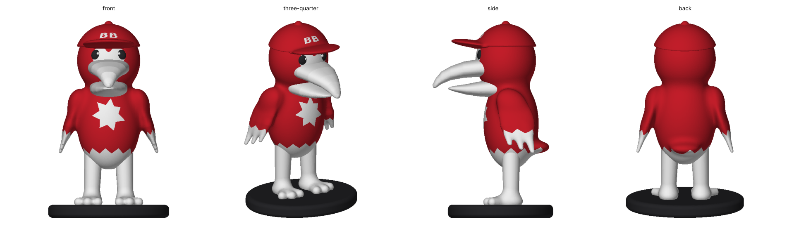

# Thunderbird mascot figurine

A small standing figurine of the Black Bob Elementary Thunderbird, the costume mascot (red bird in a red "BB" ball
cap, big white beak, white chest burst and zigzag trim). Multicolour for the AMS: red, white, black.

## Goal

A desk or shelf figurine that clearly reads as *our* Thunderbird. It's a chibi interpretation built in code, not a
scan, so the shapes are clean and easy to change by parameter. It's a sibling of `projects/black-bob-keychain` (the logo).

## Status

- [x] Source: `source/costume-photo-2026-11-14-instagram.png` (owner's screenshot of the school's Instagram post)
- [x] v1: chibi figure on a black base, 80 mm tall, 3 colours. Watertight, 0 self-intersections, colour bodies disjoint
- [x] Owner review of v1: "too pudgy and bloated", and wants smaller feet (even though the costume's are huge)
- [x] v2: slimmer torso, head, wings and legs; feet ~40% smaller; base 49 × 43
- [x] Owner review of v2: arms should be more wing-like, the beak more angular
- [x] v3: flat swept wing blades with three primary feathers; faceted beak (ridge, flat faces, sharp hook)
- [x] Owner review of v3: beak too blocky; make it big like the costume's
- [x] v4: big lofted beak (rounded sections, deep hook, open mouth)
- [ ] Owner review of v4: likeness, proportions, size, a name on the base?
- [ ] Test print (P2S + AMS 2 Pro), then adjust

## Measurements

No real object: the size is our choice. **80 mm tall** (`HEIGHT_MM`) is a first guess for "little".

| Feature | Value (mm) | Notes |
|---|---|---|
| Overall W × D × H | 49.0 × 44.6 × 80.0 | Base 49 × 43; the beak sticks out past it a little |
| Base | 49.0 × 42.6 × 5.3 | Black, rounded edge |
| Torso (design) | 24 wide × 21 deep | v1 was 32 × 28 |
| Legs | Ø ~6–7.5 | |
| Feet | ~10 long toes | v1 ~16. Owner wanted them smaller than the costume's |
| Eyes | 4.7 tall | Black, Ø 1.3 white highlight, "friendly" (as the keychain) |
| "BB" on the cap | 3.8 tall | DejaVu Sans Bold (matplotlib's bundled font) |
| Claw tips | ~0.9 | Smallest feature |
| Feather tips (wings) | ~1.3 thick | Flat primaries; tilted 19° out, swept 12° back |

Euler number of the merged solid is 0, not 2: base, leg, body, leg, base form one loop (a "handle"). That's expected.

## Print settings

- **P2S + AMS 2 Pro** (A1 + AMS lite works too): PLA, red / white / black. Indoors only, so PLA is fine.
- Open `output/thunderbird-mascot-multicolor.3mf`, load as one object with multiple parts, set the parts' filaments.
- Upright on the base. **Supports needed** under the beak, cap brim and wing tips: tree supports, "support on build
  plate only" will mostly do. 0.12–0.16 mm layers look nicer on the curves.
- Single colour: `output/thunderbird-mascot.stl`.

## Open questions

- Does it read as the Thunderbird? Beak size/hook/mouth opening (v4), the white "goggle" face patch, the chest burst.
- Wings: stand out more from the body? (`WING["tilt_deg"]`)
- v2 legs read long and thin. Shorten them, or is that fine?
- Size: 80 mm OK, or bigger (100–120 mm is easier to paint/see, more filament and time)?
- Add a name on the base ("BLACK BOB" / "THUNDERBIRDS")? A pose (waving wing)? A tail?

## Pipeline

`build.py` (~45 s):
- **Shapes** are signed-distance fields, meshed by marching cubes (0.3 mm voxel) and decimated (pymeshlab): red body
  (torso + head + wings + tail, smoothly blended), red cap, white parts (beak, legs, feet), black claws.
  Wings are built in their own frame (`wing_frame`: thickness, front-back, down the wing; tilted and swept). The beak
  is lofted (`loft_beak`): superellipse sections (exponent `BEAK_P`) through stations (y, half-width, top, bottom),
  rounded tip end. v3's angular version (profile ∩ taper ∩ roof) looked too blocky. Eyes
  and highlights are analytic spheres (marching-cubes facets that small made sliver triangles).
- **Decals** are exact boolean regions that recolour the red skin: chest starburst, face goggles (`cone_decal`: the
  outline swept from a point inside the head, so its walls meet the surface squarely), zigzag hem and wing tips
  (`zigzag_region`; the wing's is mapped into the wing frame, `wing_tip_region`), and the BB (cap only).
- **Colour bodies** (manifold3d): black = claws + eyes − highlights + base; white = white parts + highlights +
  decal regions − black; red = red − decals − white − black. Lessons: never subtract a solid that shares skin with
  the one it's cut from, avoid coplanar faces (claws are clipped 0.35 above the soles), scale *before* the booleans,
  and build the merged STL from the raw shapes, not the colour bodies. Grazing contacts also leave slivers: v2 dropped
  the red tongue (it touched the beak at shallow angles) and lowered the eyes clear of the cap rim.
- Every parameter is at the top of `build.py` in design mm (≈76 mm tall); `HEIGHT_MM` scales the result.

## Files

- `output/thunderbird-mascot-multicolor.3mf`: print this (3 parts)
- `output/thunderbird-mascot.stl`: single-colour solid
- `output/thunderbird-mascot-{red,white,black}.stl`: colour bodies
- `renders/figure.png`: front / three-quarter / side / back
- **Review page:** https://claude.ai/artifact/WYCbtWrxjguZYgr4q8fuSh (`renders/viewer.html`; republish to this URL)

## Log

- **2026-11-14 (v1):** Owner shared a photo of the costume mascot and asked for a little figurine. Built a chibi
  version: cap with BB, goggle face, hooked beak with the red mouth showing, chest burst, zigzag hem and wing tips,
  white legs and three-toed feet with black claws, black base. 80 mm tall. Published for review.
- **2026-11-14 (v2):** Owner: "too pudgy and bloated", and wants smaller feet even though the costume's are huge.
  Torso 32×28 → 24×21 (design mm), head narrower, neck blend 7 → 4, thinner wings (closer in) and legs, feet ~40%
  shorter with thinner toes and smaller claws, base 63×56 → 49×43. Beak, cap, eyes, face patch and chest burst scaled
  to the new head. Dropped the tongue (mesh slivers); the mouth still shows the red head.
- **2026-11-14 (v3):** Owner: arms more wing-like, beak more angular. Wings: flat blade (bulb + blade ellipsoids in a
  tilted, swept wing frame) with three flattened primary feathers; the white zigzag follows the wing frame. Beak: side
  profile ∩ top taper ∩ ridge roof, crisp hook. The face patch's cusps are closed with a round offset (a cusp against the
  beak ridge made slivers).
- **2026-11-14 (v4):** Owner: v3 beak too blocky, and the costume's beak is much bigger. First tried the v3 method
  scaled up: still a box. Rebuilt as a loft of rounded superellipse sections: nearly head-wide at the root, ~28 mm
  long (design), deep hook, mouth open. Beak root kept 8 mm half-width (8.8 grazed the head and made a sliver).
