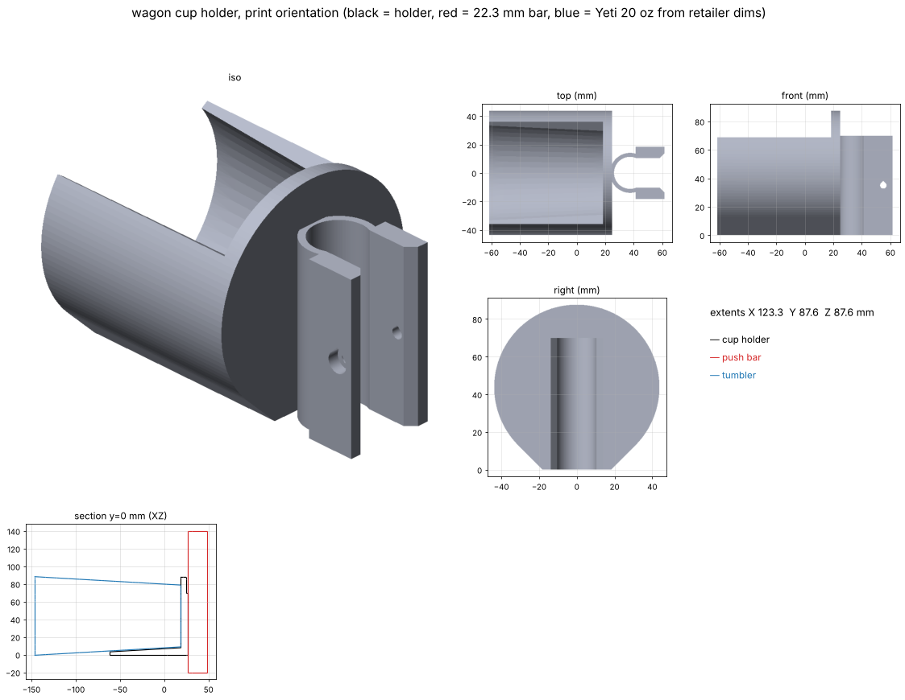

# Wagon cup holder

A cup holder that clamps onto the push bar of the owner's
[MAC Sports push/pull wagon](https://macsports.com/products/mac-sports-push-pull-wagon)
and holds a **20 oz Yeti Rambler**.

## Goal

A snap-on, bolt-tightened clip on the wagon's round push bar (the horizontal bar at the
top of the frame, above the basket), with a pocket that holds a 20 oz Yeti tumbler upright.
It goes on the **right-hand end of the bar, from the pusher's point of view**, in the ~120 mm
of free tube the owner measured.

## Status

- [x] Reference photo saved (`source/wagon-photo-2026-11-01.jpg`)
- [x] Bar measured by the owner: round, **22.3 mm** diameter, **~120 mm** free length
- [x] Parametric CAD model (`model.py`), STEP + STL, watertight, 0 self-intersections, no supports
- [x] Fits the A1 in one piece (123 × 88 × 88 mm), checked for collisions against the bar and tumbler
- [ ] **Owner: measure the actual tumbler** (base and widest diameter). The pocket uses retailer figures
- [ ] **Owner: what's around the bar?** Is there room below it for the clamp ears and bolt head?
      (Check the basket fabric/frame.)
- [ ] **Print the clip-only test slice first** (`output/wagon-cup-clip-test.stl`, 15 mm, a few minutes)
      to check the snap fit and the bolt clamp on the real bar
- [ ] Print the full holder in PETG, test on the wagon with a full cup, adjust

## Measurements

| Feature | Real (mm) | Source | Notes |
|---|---|---|---|
| Push bar outer diameter | **22.3** | owner, "about" | Calipers on a painted tube read ±0.2. Re-measure if the clip is loose or tight |
| Free bar length (right end) | **~120** | owner, "roughly" | Clip is 70 mm long and the cup is centred on it |
| Tumbler base diameter | 70 (2.75 in) | retailer listing | **Not measured on the owner's cup** |
| Tumbler widest diameter (lid) | 89 (3.5 in) | retailer listing | **Not measured on the owner's cup** |
| Tumbler height | 168–175 (6.6–6.9 in) | retailer listings | Only used to size the taper |

Retailer sources: [Rogue](https://www.roguefitness.com/yeti-rambler-20oz-tumbler),
[Rogue Canada](https://www.roguecanada.ca/yeti-rambler-20oz-stainless-limited-edition).
Enter measured tumbler values in `CUP_OVERRIDES` in `build.py`.

## Design decisions and why

- **The cup stands directly over the bar** (cup axis passes through the bar axis). The cup's weight goes
  straight down through the clip and creates no static twisting torque on the bar. It also keeps the
  holder off the pusher's side, away from hands and belly.
- **A snap-fit alone isn't enough.** A clip on a round bar is free to rotate about the bar, and a cup
  standing above it is an inverted pendulum. Rough numbers: a full cup is ~1 kg with its centre of mass
  ~100 mm above the bar, so a 1 g sideways jolt is ~0.8 N·m. A snap clip's friction at rest is ~0.1 N·m
  (the lips just touch the bar with no preload). So the clip has **two ears and an M4 bolt across the
  mouth**: tightening it pulls the C closed around the bar (roughly belt-like, so ~4× the bolt force is
  pressing on the bar, enough for ~1.5+ N·m even at modest tightness). Snapping on holds it in place while you
  tighten, and the bolt is what keeps it from rotating.
  *Hardware: 1 × M4 × 35 socket-head screw + 1 × M4 nut.*
- **Snap geometry:** the mouth is 20.7 mm wide against the 22.3 mm bar, so each arm spreads ~0.8 mm
  (≈1% strain at the 2.8 mm wall, fine for PETG). Estimated push-on force is ~5–10 kgf, so
  **test with the clip slice**. If it's too stiff, raise `mouth_width` or lower `clip_wall`. If it's loose, do the reverse.
- **Pocket:** a tapered cone (matches the Yeti's taper) 80 mm deep, with 1 mm radial clearance, wrapping the
  cup 250° so it can't slide out sideways. It's open on one side so it prints without supports.
- **Printed on its side:** the clip's bore axis is vertical on the bed. The ring's layers then run around the
  circle, so the arms flex along the layers. The pocket lies on its side on a 45° teardrop foot. No supports.
  The only steep faces are ~4 mm bridges over the bolt and nut pockets.
- **Material:** PETG (outdoor, sun, flexing clip). PLA creeps and softens in a hot car or in the sun, and
  ASA/ABS warp on the open-frame A1.

## Print settings (suggested, not yet test-printed)

- PETG, 0.2 mm layers, 4–5 walls, 15–20 % gyroid infill, brim on (it's 88 mm tall on a 35 mm wide foot).
- Orientation is already built into the STL: clip bore vertical, pocket on its side. Don't re-orient it.
- Volume 155 cm³ solid. Expect roughly 70–90 g with those settings.
- If the clip arms crack when snapping, print the clip slice with more walls and a lower mouth interference first.

## Open questions

1. Is there room under the bar for the ears (they stick ~22 mm below the bar axis) and the bolt head?
   If not, the mouth can face another direction (e.g. toward the pusher), or the bolt can move.
2. Does the right-hand end have the full 70 mm of clear bar, with the cup (88 mm wide at the pocket) overhanging
   past the clip? Anything near the end of the bar that the pocket would hit?
3. Does the owner's tumbler have a handle? (The pocket assumes the plain Rambler.)
4. Would a rubber strip or inner-tube liner on the bar be wanted for extra grip? (Easy to add.)
5. The wagon folds. Does the holder need to come off to fold it? (It does: undo the bolt, pull it off.)

## Pipeline

`python projects/wagon-cup-holder/build.py` (~1 min):
1. `model.py` (build123d): clip ring → ears → floor plate + teardrop pocket (cone cavity, side opening) →
   cut bore, mouth, bolt hole, head pocket, nut trap. Built in the **print frame** (bar axis = Z).
2. `build.py` rotates it 90° about Z so the longest axis is X, centres it, exports STEP + STL, and builds
   the 15 mm clip test slice.
3. Checks: watertight, 0 self-intersections, interference with a ghost bar and a ghost tumbler (both must be 0),
   overhang area. Writes `output/report.json` and the renders.

Key parameters (`CupHolderParams` in `model.py`): `bar_d`, `bar_clearance`, `clip_wall`, `clip_len`,
`mouth_width`, `cup_base_d`, `cup_top_d`, `pocket_depth`, `pocket_clearance`, `wrap_deg`.

## Files

- **Interactive viewer:** https://claude.ai/artifact/Anqg9yywWNz2pW6LNgwWoN (private to the owner).
  Built from `renders/viewer.html` by `tools/make_viewer.py` using `review.json`. Republish to this
  URL on every review (see `docs/review.md`)
- `source/wagon-photo-2026-11-01.jpg`: the owner's photo (arrow marks the bar)
- `model.py`: parametric CAD. `build.py`: pipeline
- `output/wagon-cup-holder.step`: editable solid for Fusion (print orientation)
- `output/wagon-cup-holder.stl`: print-ready holder
- `output/wagon-cup-clip-test.stl`: 15 mm clip-only slice for the fit test
- `output/report.json`: dimensions, checks, parameters
- `renders/cup-holder.png`, `renders/sections.png`, `renders/in-use.png`: previews and sections
- `renders/ref-bar.stl`, `renders/ref-tumbler.stl`: ghost bar and tumbler for the viewer

## Log

- **2026-11-01:** Project started. The wagon page gives no tube sizes, so I asked the owner. They pointed to the round
  push bar at the top of the frame (photo) and measured it: 22.3 mm round, ~120 mm free, wants it on the
  pusher's right. Tumbler sizes are from retailer listings (not measured). Built the parametric model: snap C-clip
  + M4 clamp bolt + floor plate + tapered pocket, with the cup standing over the bar. Found while checking the
  physics that a snap-fit alone has ~10× too little grip against rotating around the bar, so I added the
  clamp ears and bolt. Watertight, 0 self-intersections, no collisions with the bar or tumbler, prints with no
  supports, 123 × 88 × 88 mm. Next: owner reviews the viewer, measures the tumbler, prints the clip slice.
